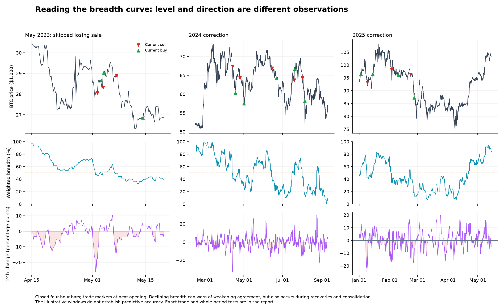
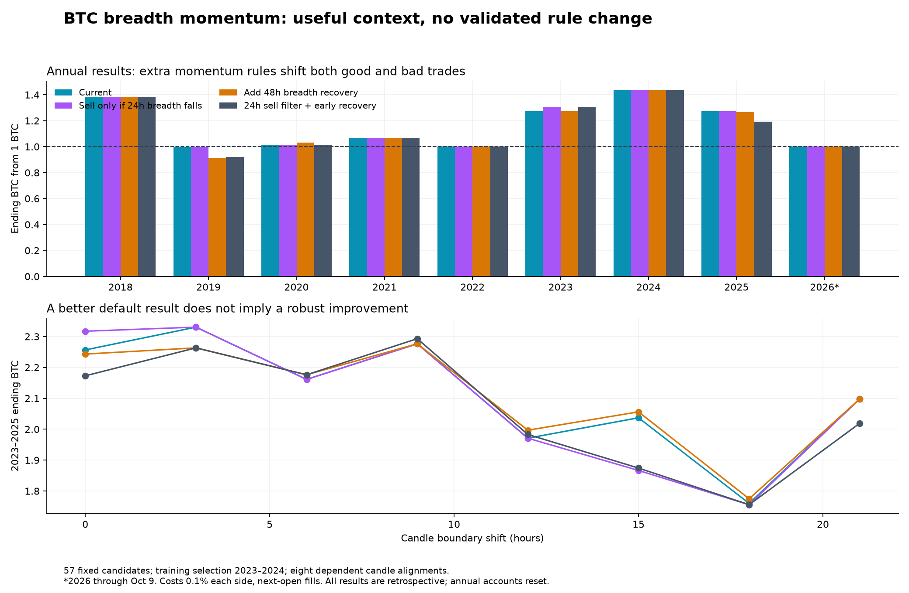

# Does BTC breadth momentum add value?

Completed 19 October 2026. **It adds descriptive context, but this experiment does not validate changing the live trading rule.** Tested 57 predeclared candidates across eight candle alignments. The training-selected sell filter improves 2023–2025 from 2.2566 to 2.3173 BTC by skipping one losing trade, but improves only one of eight alignments. No shortlisted rule passes the replacement criteria.

## What the curve means

Our breadth is a weighted agreement score across indicators/timeframes of BTC itself. It is not advancing-versus-declining participation across many assets, and its momentum is not independent evidence from a new data source. A reading of 55% while rising describes improving agreement; the same level while falling describes deterioration. Neither reading is a calibrated probability.

Traditional breadth-momentum tools exist: the [McClellan Oscillator](https://chartschool.stockcharts.com/table-of-contents/market-indicators/mcclellan-oscillator) applies a difference of moving averages to advance/decline data. That supports testing the idea, not transferring its effectiveness to our BTC score.

Four useful descriptive features are the level, change in percentage points, persistence of rises/falls, and distance below a recent peak. Acceleration means the change in that momentum. A declining curve above 50% can still be stronger than a rising curve below 50%. Near a plateau, an unchanged percentage means the same balance of bullish votes, not necessarily unchanged price momentum.

## Test design

Weights stay [1,1,1,1,1,2], with 72% iMACD / 28% daily. All candidates retain the daily SMA200 regime, 10% BTC target and seven-day buyback timeout. All 57 named rules are published:

- 21 sale filters: slope, acceleration, persistence, breadth EMA spread and distance below recent peak.
- 8 extra early-sale triggers while breadth remains between 50% and 60/65%.
- 18 recovery variants, including momentum-confirmed recovery and recovery before 50%.
- 9 combinations plus the unchanged baseline.

Select using the lower quartile of annualized log BTC across eight alignments in 2023–2024, minimum five round trips per alignment. 2025/2026 are evaluation periods, but were already researched; they are not pristine holdouts. All signals use completed candles and next-open execution. Sale filters only accept/reject a fresh baseline event, rather than inventing a later entry in the same weak run.

## Selected rules

| Selection | Rule | Meaning |
|---|---|---|
| Sale only | `sell_slope6_0` | Sell only if current breadth is lower than 24 hours earlier, in addition to the original sale conditions. |
| Recovery only | `buy_early12_10` | Also buy below 50% when breadth is above 40% and has risen more than 10 percentage points in 48 hours. |
| Overall | `both_slope6_0_early6_10` | The 24h falling-breadth sale filter, plus early recovery above 40% after a >10-point rise in 24h. |

## Results from 1 BTC

Each annual account resets. Multi-year accounts carry positions continuously. Costs 0.1% each side. * = cash valued as purchasable BTC after its buy fee. 2026 stops October 9, matching the frozen data used by the earlier studies.

| Window | Current | 24h sale filter | Early 48h recovery | Combined |
|---|---:|---:|---:|---:|
| 2018 | 1.3843 | 1.3843 | 1.3843 | 1.3843 |
| 2019 | 0.9970 | 0.9970 | 0.9104 | 0.9192 |
| 2020 | 1.0135 | 1.0135 | 1.0320 | 1.0135 |
| 2021 | 1.0694 | 1.0694 | 1.0694 | 1.0694 |
| 2022 | 1.0000 | 1.0000 | 1.0000 | 1.0000 |
| 2023 | 1.2737 | 1.3080 | 1.2737 | 1.3080 |
| 2024 | 1.4339* | 1.4339* | 1.4339* | 1.4339* |
| 2025 | 1.2735 | 1.2735 | 1.2660 | 1.1942 |
| 2026 | 1.0000 | 1.0000 | 1.0000 | 1.0000 |
| 2023–2024 training | 1.8264* | 1.8755* | 1.8264* | 1.8755* |
| 2020-21 | 1.0838 | 1.0838 | 1.1037 | 1.0838 |
| 2023-25 | 2.2566 | 2.3173 | 2.2432 | 2.1729 |
| 2025-26 | 1.2735 | 1.2735 | 1.2660 | 1.1942 |

## Why the apparently good filter is not enough

The 24-hour falling-breadth sell filter skips the 3 May 2023, 20:00 UTC sale and 4 May, 00:00 UTC recovery buyback. That round trip lost **2.62% BTC after costs**. Avoiding this one trade accounts for the entire default 2023–2025 improvement. The recent-cycle comparison across alignments is **1 win, 5 ties, 2 losses**.

| Rule | Default 2023–25 | Median | Worst–best | Wins / ties / losses vs current |
|---|---:|---:|---|---|
| Current | 2.2566 | 2.1297 | 1.7599–2.3304 | 0 / 8 / 0 |
| Sell only if 24h breadth falls | 2.3173 | 2.1297 | 1.7555–2.3304 | 1 / 5 / 2 |
| Add 48h breadth recovery | 2.2432 | 2.1372 | 1.7749–2.2765 | 4 / 2 / 2 |
| 24h sell filter + early recovery | 2.1729 | 2.0961 | 1.7557–2.2929 | 3 / 0 / 5 |

Buying earlier on improving breadth can avoid missing a rally, but it can also re-enter before a decline finishes. The 24h early-recovery rule alone lowers default 2025 from **1.2735 to 1.1942 BTC**. The illustrative earlier-sale rule below 65% finishes 2023–2025 at **2.2645 BTC**, but lowers 2025 to **1.2477 BTC**. These are diagnostic controls, not replacements selected after seeing later results.

## Does rising versus falling breadth predict the next move?

This descriptive check samples one close per day when breadth is 45–55%, under a bullish daily regime. Falling/rising means a 24h change below −5 / above +5 percentage points; flat is between. Returns start at the next opening. Seven-day outcomes overlap, samples are small, and these percentages are not calibrated trade confidence.

| Period | Momentum | Samples | Mean next 24h return | Mean next 7d return | ≥10% drop within 7d |
|---|---|---:|---:|---:|
| 2018-22 | falling | 20 | -1.19% | -2.20% | 15.0% |
| 2018-22 | flat | 44 | +0.23% | -0.78% | 27.3% |
| 2018-22 | rising | 14 | -0.74% | +0.89% | 21.4% |
| 2023-24 | falling | 11 | -0.30% | -3.69% | 45.5% |
| 2023-24 | flat | 21 | +0.12% | +1.69% | 9.5% |
| 2023-24 | rising | 9 | +0.33% | +0.41% | 11.1% |
| 2025-26 | falling | 6 | -0.79% | +1.04% | 0.0% |
| 2025-26 | flat | 11 | +0.34% | +1.68% | 9.1% |
| 2025-26 | rising | 8 | +0.35% | -0.74% | 12.5% |

Falling breadth looked ominous in 2023–2024, but the later seven-day comparison reverses: falling cases averaged positive returns while rising cases averaged negative returns. That instability is why a visually convincing shape is insufficient to classify a crash reliably. These samples also do not match breadth levels exactly, control for volatility, or measure independent effects.

## Costs, delay and risk

| Stress / rule | Default 2023–25 BTC | Worst 2023–25 BTC | Wins vs current |
|---|---:|---:|---:|
| 0.3% each side · Current | 2.0500 | 1.5797 | 0/8 |
| 0.3% each side · Sell only if 24h breadth falls | 2.1136 | 1.5821 | 2/8 |
| 0.3% each side · Add 48h breadth recovery | 2.0379 | 1.5932 | 4/8 |
| 0.3% each side · 24h sell filter + early recovery | 1.9819 | 1.5823 | 4/8 |
| Extra 4h · Current | 2.5368 | 1.7288 | 0/8 |
| Extra 4h · Sell only if 24h breadth falls | 2.5447 | 1.7331 | 2/8 |
| Extra 4h · Add 48h breadth recovery | 2.5236 | 1.7599 | 4/8 |
| Extra 4h · 24h sell filter + early recovery | 2.4021 | 1.7346 | 4/8 |
| 0.3% + extra 4h · Current | 2.3046 | 1.5518 | 0/8 |
| 0.3% + extra 4h · Sell only if 24h breadth falls | 2.3210 | 1.5619 | 2/8 |
| 0.3% + extra 4h · Add 48h breadth recovery | 2.2926 | 1.5797 | 4/8 |
| 0.3% + extra 4h · 24h sell filter + early recovery | 2.1910 | 1.5632 | 4/8 |
| Extra 24h · Current | 1.9540 | 1.2354 | 0/8 |
| Extra 24h · Sell only if 24h breadth falls | 1.9540 | 1.2354 | 0/8 |
| Extra 24h · Add 48h breadth recovery | 2.0278 | 1.2652 | 5/8 |
| Extra 24h · 24h sell filter + early recovery | 1.9869 | 1.2660 | 3/8 |

| Rule | 2023–25 BTC drawdown | Dollar drawdown | 2025 round trips |
|---|---:|---:|---:|
| Current | -12.32% | -25.54% | 8 |
| Sell only if 24h breadth falls | -12.32% | -25.54% | 8 |
| Add 48h breadth recovery | -12.32% | -25.54% | 8 |
| 24h sell filter + early recovery | -12.32% | -25.54% | 8 |

Drawdowns are sampled at four-hour closes. BTC preservation does not ensure dollar protection.

## Decision and verification

Keep the live strategy unchanged. A 24h breadth-change readout can be useful descriptive context, but the tested slope, acceleration and early-turn rules do not establish a sufficiently consistent trading improvement. No claim is made that every conceivable breadth-shape rule has been exhausted.

Validation: 15 baseline ledger matches against the previously production-verified model; 114 all-rule future-truncation checks; 105 independent bar-by-bar ledgers, plus separate fee/cash reconstruction. The frozen source hash matches the earlier study; the same 122 missing hourly timestamps in 27 gaps remain.

Files: [predeclared protocol](PROTOCOL.md), [all 57 rules](candidates.csv), [full phase/stress and descriptive results](summary.json), [trade ledger](trades.csv), [historical plot data](chart-data.csv). Reproduce with `evaluate.py`, then `report.py`.
