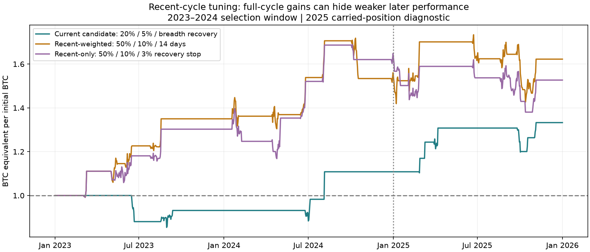

# Does newer Bitcoin history deserve more weight?

Research completed 11 October 2026. **Yes, recent-cycle weighting is a defensible research preference. It produces a stronger full-cycle fit here, but does not establish that the chosen parameters forecast the next cycle better.**

## Is there evidence that the recent cycle differs?

| Supplied bull window | Annualized daily log-return volatility | Median rolling 30-day annualized volatility | Daily-close maximum drawdown |
|---|---:|---:|---:|
| 2015-17 | 74.3% | 58.5% | -45.7% |
| 2019-21 | 76.9% | 64.3% | -63.3% |
| 2023-25 | 46.2% | 43.7% | -32.0% |

Volatility is substantially lower in 2023–2025. It is not monotonically lower across all cycles: 2019–2021 was more volatile than 2015–2017 by this measure. These metrics describe the sample; they cannot identify the change as being caused by maturity or guarantee that future volatility or crash risk declines.

Fidelity’s [A Closer Look at Bitcoin’s Volatility](https://www.fidelitydigitalassets.com/research-and-insights/closer-look-bitcoins-volatility) documents a long-term decline in realized volatility and discusses a growing capital base. Glassnode’s [Thinking Ahead](https://research.glassnode.com/the-week-onchain-week-04-2025/) discusses diminished cycle growth and a more mature market structure. Those sources support testing the hypothesis, not the specific trading thresholds below.

## Selection method

The [protocol](RECENCY_PROTOCOL.md) was written before this new run. Reuse all 216 rules from the original grid. Rank their 25th-percentile annualized log BTC growth across eight candle alignments. Recent-only selection uses 2023–2024. Recent-weighted selection uses illustrative weights of 60% on 2023–2024, 30% on 2019–2021, and 10% on 2015–2017. The weights express a preference, not a fitted estimate of predictive relevance. Earlier losses no longer veto a rule.

Selection scores exclude 2025 returns. Nevertheless all history, including 2025, was already viewed during earlier research and helped shape the grid and baseline. This is a retrospective chronological diagnostic, not an untouched holdout or evidence of live performance.

Costs are 0.10% per side, next-open fills after completed candles. Start each independent replay with 1 BTC. Cash is measured after its hypothetical BTC purchase fee. The calendar bear exit remains separate.

## Results

| Selection | 2023–2024 training, base | Continuous 2023–2025, base | 2025 carried account: BTC growth | Fresh 1 BTC in 2025 |
|---|---:|---:|---:|---:|
| Current conservative candidate | 1.1083 BTC | 1.3327 BTC | +20.25% | 1.2025 BTC |
| Recent-only winner | 1.6297 BTC | 1.5268 BTC | -6.32% | 0.9743 BTC |
| Recent-weighted winner | 1.5427 BTC | 1.6224 BTC | +5.17% | 0.9739 BTC |
| Full-cycle hindsight winner | 1.3033 BTC | 1.7379 BTC | +33.35% | 1.3933 BTC |

Carried growth divides year-end 2025 BTC equivalent by year-end 2024 BTC equivalent without resetting units, cash or pending decisions. A fresh account starts January 2025 holding exactly 1 BTC. The selected weighted rule entered 2025 in cash in its simulated continuous history; an investor adopting it fresh in January would not automatically inherit that cash position. This difference matters and both results are retained. Training return multiplied by the fresh-account result need not equal the continuous result.

## What recent weighting actually changes

Recent-weighted selection chooses `e50_ma200_gain0.1_time14`:

- Keep the same buffered SMA200 gate: two daily closes above 102% to turn bullish, two below 98% to turn bearish.
- Sell the full account after breadth crosses below **50%**, instead of below 20%. This permits earlier and more frequent tactical exits.
- Target **10% additional BTC**, instead of 5%, using the same fee-adjusted buyback formula.
- Buy back when the target is reached or after **14 days in cash**, rather than waiting for breadth above 60%. All fills remain next-open.

The maturity hypothesis itself does not imply a 10% target, a 50% breadth threshold or a 14-day timeout. These emerged from the particular training sample and ranking. In particular, lower volatility does not automatically imply that lowering every percentage threshold will improve accumulation.

Recent-only selection chooses the same 50% breadth and 10% target, but uses a recovery buyback when price closes 3% above the actual sale price. Its continuous account loses BTC during 2025 on all eight alignments, despite the impressive 2023–2024 training fit.

The full-cycle hindsight winner uses 50% breadth, a 3% target and the 14-day timeout. Its 1.7379 BTC full-cycle result was selected using all of 2023–2025, including the evaluation year; it is explicitly not a forecast test.

## Alignment and execution sensitivity of the recent-weighted winner

| Separate stress | Continuous 2023–2025 BTC range | Fresh 2025 BTC range | Fresh 2025 alignments above 1 BTC |
|---|---:|---:|---:|
| Base | 1.2077–1.8534 | 0.9414–1.2061 | 1/8 |
| 0.30% cost each side | 1.1149–1.7246 | 0.9118–1.1681 | 1/8 |
| Extra 4h execution delay | 1.2638–1.9874 | 0.9698–1.1510 | 4/8 |
| Extra 24h execution delay | 1.1962–1.9342 | 0.9742–1.1517 | 5/8 |

At base costs, the weighted rule’s carried 2025 BTC growth is +1.82% to +23.75%, positive on all eight alignments. Its fresh-account result is positive on only 1/8. Eight alignments reuse the same prices and are sensitivity checks, not independent market samples.

It also has meaningful earlier-cycle exposure: 2015–2017 ends at 0.8853 BTC at the base alignment (0.6595–1.2013 across alignments), while 2019–2021 ends at 1.3588 BTC (1.1813–1.6457). A recent preference allows this tradeoff; it does not make those losses disappear.

| Additional fresh-account test of weighted rule | Default BTC | Eight-alignment range |
|---|---:|---:|
| 2020-21 | 1.1228 | 1.1228–1.4545 |
| 2022 | 1.0000 | 1.0000–1.0000 |
| 2026 through Oct 9 | 1.0000 | 1.0000–1.0000 |

The 2026 cutoff is October 9 UTC. These are standalone overlays; the combined calendar framework is in cash during bear years.

## Neighboring parameters

Keep SMA200 and the 14-day recovery; inspect immediately adjacent breadth and target settings from the existing grid. These were not used to revise the selected rule after seeing 2025.

| Rule | Default 2023–2025 BTC | Fresh 2025 BTC range | Fresh 2025 wins / alignments |
|---|---:|---:|---:|
| e40_ma200_gain0.05_time14 | 1.2404 | 0.9299–1.0655 | 7/8 |
| e40_ma200_gain0.1_time14 | 1.5588 | 1.0071–1.2695 | 8/8 |
| e40_ma200_gain0.15_time14 | 1.0278 | 0.9704–1.2109 | 6/8 |
| e50_ma200_gain0.05_time14 | 1.4919 | 0.8813–1.1824 | 1/8 |
| e50_ma200_gain0.1_time14 | 1.6224 | 0.9414–1.2061 | 1/8 |
| e50_ma200_gain0.15_time14 | 1.4142 | 0.9964–1.2519 | 6/8 |

## Interpretation

Give modern data more relevance and retain old periods as stress scenarios. The weighted candidate is a plausible modern-cycle alternative, with a higher continuous recent-cycle result and better 24-hour-delay behavior than the conservative candidate. Its weaker fresh-2025 result and earlier losses mean it has not demonstrated general superiority. Recent-only optimization failed the subsequent carried-year check outright.

Do not equate better retrospective fit with better projection. A volatility-scaled target would be another distinct hypothesis requiring a fixed formula and its own chronological evaluation; this run did not test or validate one. Likewise, if maturity changes the market structure, the exact four-year calendar exit deserves future scrutiny too. This study keeps it fixed to isolate the overlay comparison.

No live model or calendar position was changed. Reproduce using `recency.py` followed by `recency_report.py`; inputs and dependencies match the [main report](REPORT.md). All 216 × 8 training/test records, scores and stress results are in [recency-results.json](recency-results.json); carried-account and neighboring-rule diagnostics are in [recency-diagnostics.json](recency-diagnostics.json). Checks confirm selection from the declared training scores, baseline parity with the prior run, positive ledger values and valid cash fractions. Each simulation also independently reconciles the actual sale/buy price ratios after fees.
