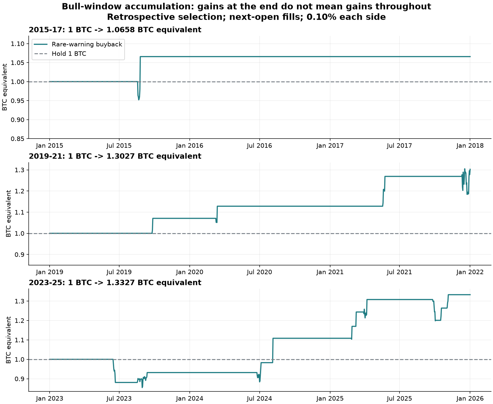

# Bull-window accumulation and crash/range discrimination

Research completed 11 October 2026. Historical simulation; no untouched forward validation.

**A concrete candidate beat 1 BTC in each of the three supplied bull windows, including all eight candle alignments. It is not an always-winning strategy or a reliable crash classifier. A 24-hour execution delay breaks the recent-cycle result.**

## Scope and correction to the previous comparison

The earlier 1,709-configuration study required one allocation to accumulate BTC in both bull and bear windows while reducing bear dollar drawdowns. That was broader than the clarified objective. Here the supplied calendar framework handles the strategic bear exit; the overlay only seeks extra BTC during 2015–2017, 2019–2021 and 2023–2025. These windows come from the existing adjacent quant research (`r26_cycles.py`, `r27_hybrid.py`, `r31_bullyears.py`). They are an assumption supplied by the user, not a newly verified forecast of future cycles.

Start each window with exactly 1 BTC, fully invested; no inherited bear-market cash, deposits, yield, leverage or shorting. Warm indicators using earlier prices. The reported result is before the common strategic exit from the bull window. Cash is valued as BTC after its purchase fee; that is a valuation, not a claim that the account actually holds those coins.

## Candidate: rare breadth break, 5% BTC buyback target

Configuration: `e20_ma200_gain0.05_trend`. The account trades its full BTC balance.

1. Permit sales only inside the supplied bull window and while a buffered daily SMA200 regime is bullish: two consecutive closes above 102% of SMA200 turn it on; two below 98% turn it off; retain the last state between those events.
2. Sell at the next 4-hour open after the existing 50-member Average breadth crosses from at least 20% to below 20%. This is the fraction of members voting bullish, not a predicted crash probability.
3. After the actual sale, buy back at the next 4-hour open following either a close below the 5%-BTC-gain hurdle, or breadth above 60%, whichever occurs first. The hurdle at base costs is `sale price × 0.999 / (1.001 × 1.05)`, about 95.048% of sale price. Next-open gaps can change the realized gain.
4. Require a fresh crossing below 20% for another sale. A full return above 60% is not needed to re-arm. The buyback rule remains active if the SMA gate turns off while the account is in cash.

This changes the original Average in two material ways: it tolerates substantially more ordinary weakness before selling, and it buys back after a sufficient dip without waiting for bullish trend confirmation. The fallback still sometimes forces a costly buyback higher.

## Results per starting BTC

| Bull window | Hold | Default replay | Range across 8 alignments | Completed round trips | Winning round trips | Ending cash? |
|---|---:|---:|---:|---:|---:|---|
| 2015-17 | 1.0000 | 1.0658 | 1.0510–1.0658 | 1 | 1 | No |
| 2019-21 | 1.0000 | 1.3027 | 1.1819–1.6708 | 4 | 4 | Yes |
| 2023-25 | 1.0000 | 1.3327 | 1.1074–1.3378 | 10 | 8 | No |
| 2020-21 | 1.0000 | 1.2166 | 1.0784–1.5509 | 3 | 3 | Yes |

The 2020–2021 diagnostic overlaps the 2019–2021 window and is not an independent cycle. In 2019–2021, ending cash contributes to the result: the final December sale has not bought back by year-end. In 2015–2017 there is only **one** completed trade. Eight alignments are sensitivity checks on the same history, not eight independent confirmations.

## Costs, timing and selection uncertainty

| Separate stress | Bull cycles beating 1 BTC at every alignment | 2023–2025 range | 2020–2021 range |
|---|---|---:|---:|
| 0.10% each side, next open | 3/3 | 1.1074–1.3378 | 1.0784–1.5509 |
| 0.30% each side, next open | 3/3 | 1.0682–1.2853 | 1.0698–1.5263 |
| 0.60% each side, next open | 3/3 | 1.0121–1.2105 | 1.0571–1.4901 |
| 0.10% each side, extra 4-hour delay | 3/3 | 1.0383–1.3218 | 1.1401–1.6846 |
| 0.10% each side, extra 24-hour delay | 2/3 | 0.7174–0.8195 | 1.1748–1.9165 |

Costs and delays above are separate tests, not combined stresses. Cost stress leaves the nominal 5% target unchanged. Delay stress replays decisions and recomputes the target from the actual delayed sale; it does not simply shift a precomputed trade list. Fills assume the recorded open is available, without order-book depth, outages or stochastic slippage. The higher-cost tests are a friction sensitivity, not proof of executable prices.

Moving both window boundaries by −90, −30, +30 or +90 days also leaves each tested window above 1 BTC at the default alignment. This is boundary sensitivity only; the shifted windows enter neighboring calendar years and are not the adopted framework.

The adjacent 3% buyback target also passes all three cycles across all alignments at base costs, but is weaker under high costs and delay. Of 216 configurations in the new grid, 14 passed the three default bull windows; only two passed all three across all eight alignments. The 20%/5% candidate was chosen after inspecting this history and its sensitivities. This search follows earlier searches on the same data, so its apparent edge remains exposed to selection bias.

Chronological selection was also checked mechanically. Choosing the highest-return configuration using only 2015–2017 selects `rsi80_ma0_gain0.15_stop3`, which subsequently ends 2023–2025 at **0.6717 BTC**. Choosing the rule with the best minimum result across the first two cycles selects the 40%-breadth/10%-gain rule, which ends 2023–2025 at 1.6882 BTC at the default alignment, but fails the all-alignment three-cycle check (5/8 passes). Thus the selected 20% rule is a retrospective candidate, not the output of a proven prospective model-selection procedure.

## Losses and the named corrections

| Fresh annual account | Ending BTC |
|---|---:|
| 2015 | 1.0658 |
| 2016 | 1.0000 |
| 2017 | 1.0000 |
| 2019 | 1.0708 |
| 2020 | 1.0536 |
| 2021 | 1.1547 |
| 2023 | 0.9318 |
| 2024 | 1.1895 |
| 2025 | 1.2025 |

Annual tests reset to 1 BTC; they are not a decomposition of the continuous account when cash crosses year-end. The 2023–2025 account falls to 0.8808 BTC after the June 2023 sale near $24,984 and forced recovery buyback near $28,308. It stays below 1 BTC until August 2024. Its maximum BTC-equivalent drawdown is **15.91%**. The 2019–2021 dollar drawdown is still **63.11%**; this is an accumulation overlay, not full crash protection.

- During the 2024 correction, it sells June 25 near $60,293 and buys July 5 near $57,050, then sells August 4 near $60,896 and buys August 5 near $53,891. It neither sells at $70k nor buys the precise low near $49k.
- During the early-2025 correction, it sells February 26 near $88,680 and buys near $83,857, then trades March 9–10 near $86,005/$80,734 and March 30–April 7 near $82,649/$78,430. It has already endured the fall from the January high before the first sale.
- In March 2020 it buys back on March 12 around $7,392, before the worst part of the crash. More BTC from a completed trade does not mean the crash has ended.
- A September 2025 false alarm sells near $108,994 and buys back near $118,490, losing BTC again.

See [every fill](trades.csv), including UTC decision/fill timestamps, fees in the engine, and the full account history in [validation-results.json](validation-results.json).

## Can crashes, consolidations and chop be separated with certainty?

**No certainty is established.** We can identify that prices have recently been range-bound or that trend breadth has weakened. That does not identify the next path with certainty. A severe drawdown can also occur inside a multi-month consolidation; these labels need a defined horizon and need not be mutually exclusive.

A separate, fixed diagnostic uses only completed daily/4-hour data for features. It defines a future crash as a low at least 15% below the next executable daily open within 30 days; a quiet outcome keeps every subsequent high and low within ±10% of that open. A range screen requires 20-day efficiency below 0.20 and trailing 30-day high/low width at most 20%. Efficiency is absolute net price change divided by the sum of absolute daily changes. A range break means a later daily close above 101% of the frozen trailing high or below 99% of the frozen trailing low. Parameters were fixed for this diagnostic, not optimized to maximize the outcomes.

Signals below are spaced at least 30 days apart; labels must finish before the bull window ends. Four-hour crossings are collected into daily warning observations and evaluated at that day’s close, including crossings while the account is already in cash. These are screen counts rather than a list of executed trades. These are historical frequencies, not calibrated probabilities. All warning/range screens and daily observations are retained in [regime-results.json](regime-results.json).

| 2023–2025 screen | Spaced observations | Further ≥15% fall within 30d | Entire next 30d within ±10% | Frozen range breaks within 30d |
|---|---:|---:|---:|---:|
| always | 36 | 5 | 10 | 26 |
| breadth<40% | 21 | 4 | 3 | 16 |
| breadth<20% | 12 | 2 | 2 | 8 |
| rare gated breadth crossing | 8 | 2 | 1 | 5 |
| low efficiency + narrow range | 24 | 4 | 6 | 18 |
| ADX14<20 | 19 | 3 | 2 | 14 |
| range + ADX14<20 | 15 | 2 | 2 | 11 |

The rare gated warning produces only **2/8** spaced subsequent-crash labels in 2023–2025; six alerts do not lead to a further 15% fall within 30 days. That is different from a failed trade: a 5% BTC buyback can succeed without a 15% crash. On all daily observations, breadth below 20% has a 16.1% subsequent-crash frequency, versus 16.3% across all eligible days. Those daily labels overlap and cannot be treated as independent samples.

The range screen gives **24** spaced observations in 2023–2025. **18** break a frozen boundary within 30 days; only **6** remain within ±10% of the next-open price throughout that period. Adding ADX below 20 leaves **15** observations, with **11** boundary breaks and only **2** quiet outcomes. Across 2015–2017 and 2019–2021, the same basic range screen has respectively 11/13 and 7/8 boundary breaks. The screen recognizes recent chop; it does not promise future range persistence.

A range can still be tradable for several days before it breaks. These figures do not prove that every range-trading rule loses. They do rule out interpreting these particular range screens as certainty that boundaries will hold for a month. We have not tested every possible crash classifier, order-flow feature or range strategy.

The useful separation is between **condition recognition**, **future prediction** and **trade profitability**. The selected overlay can add BTC by capturing some ordinary dips while remaining a poor classifier of large future crashes. A strategy does not need certainty to have positive expectancy, but its full net BTC outcome and failure cases must be checked.

Contemporaneous research also described the 2024 market as both correction and consolidation, with volatility compression that could precede a larger move; it did not establish a deterministic direction. See Glassnode’s [Surviving Bull Drawdowns](https://research.glassnode.com/the-week-onchain-week-18-2024/) and [A Macro Reset](https://research.glassnode.com/the-week-onchain-week-21-2024/). The numerical findings above come from our own replay, not those articles.

## Verification and reproduction

- `bull.py`: 216 configurations, default full ledgers, 14 shortlisted rules across eight alignments.
- `validate.py`: full-account replay under separate cost/delay stresses, annual resets, shifted boundaries, neighboring rule and chronological selection. Causal prefix checks remove all future bars at three dates, including unfinished daily tails.
- `regimes.py`: fixed crash/range diagnostic, all counts and timestamped spaced observations; three causal feature-prefix checks.
- `tests/btc-bull-accumulation.test.py`: independent synthetic ledgers verify next-open execution, actual delayed-sale repricing, fixed targets under cost stress, terminal cash fees, buy-and-hold and a losing recovery trade.
- Every completed cash round trip independently reconstructs the ending BTC by multiplying actual sell/buy price ratios after both fees.

Run `bull.py`, `validate.py`, `regimes.py`, then `report.py` using Python with NumPy/SciPy/Matplotlib. Inputs require the adjacent `../quant/research_notes/ensemble_v2` caches and this repository’s `research/btc-corrections-2023-2025/extension-2026.json`. Prices combine rescaled Bitstamp before Binance availability with Binance BTCUSDT afterward. The inherited source has one known missing hour on 2023-03-24; it is retained, not fabricated. The full cache ends on October 9, 2026 UTC, but all primary bull tests end at January 1, 2026. All times are UTC.

This is a promising historical bull-window candidate with material execution and selection risks. It does not establish guaranteed BTC accumulation, universal crash prediction, or a replacement for the supplied strategic cycle exit.
