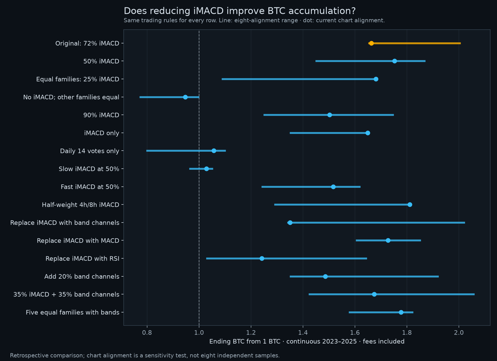

# iMACD weighting and alternative breadth indicators

Completed 11 October 2026. We reviewed the earlier ensemble notes and tested 288 fixed combinations: 16 breadth definitions × three exit thresholds × two confirmation lengths × three buyback modes, each across eight candle alignments. All history was previously examined; these are retrospective experiments, not independent forecasting evidence.

**Finding:** the numerical dominance of iMACD is real, but equal family weights did not produce a robust improvement. Removing iMACD and equal-weighting the remaining families lost BTC throughout the recent cycle in all eight alignments. Plain MACD is a plausible alternative, but the evidence does not establish it as a universal upgrade. The earlier >50% recovery-buyback candidate remains a more useful comparison than simply reducing the iMACD weight. The displayed Average and refined strategies have not been replaced.

## What the previous research found

Read-only sources in the adjacent quant repository: `reports/iMACD ensemble.md` (weighting addendum); `reports/Average strategy v2 research.md` (rounds 5 and 5b); `research_notes/ensemble_v2/r20_tfweight.py` and `r25_indicator_screen.py`.

The old Average model tested equal family weights, dropping iMACD, downweighting fast timeframes, ordinary MACD, and 24 alternative indicator families. Equal families reduced 2019+ spot Sharpe by approximately 0.09; dropping iMACD reduced it by approximately 0.16. The notes attribute part of iMACD’s contribution to its channel/dead-band behavior, which avoids declaring an upward trend during small price movements. The Keltner/Bollinger breakout family was the closest alternative in the broad screen, but did not meet its adoption criteria.

Those results used dollar returns, drawdown and risk-adjusted performance under the old sizing/funding mapping. They do not settle the present objective of gaining BTC through tactical exits and buybacks, which is why the new test uses our BTC ledger.

## Is the 72% weight inherently excessive?

The original weights are iMACD 72%, SMA 10%, momentum 10%, Donchian 8%. Equal weighting each family changes that to 25% each. The 50% experiment gives iMACD 50% and each other family 16⅔%. Equal family names do not mean independent information: all are transformations of the same BTC price history. In 2023–2024, SMA-family and momentum-family breadth had correlation 0.880; it was 0.917 in 2025. iMACD’s correlations with other families were also high (approximately 0.80–0.82 in training). These are descriptive correlations across consecutive, overlapping observations, not independent statistical tests.

## Isolate the weighting change

Every row below keeps the original sale threshold below 50%, three-close confirmation, 10% BTC target and seven-day timeout. The same buffered daily SMA200 gate applies. Start with 1 BTC, use next-open fills and 0.10% costs each side. Multi-year windows are continuous accounts. * means ending cash valued as BTC after its purchase fee.

| Breadth definition | 2020 | 2025 | 2023–2025 | Recent-cycle range across alignments | Beats original in recent cycle |
|---|---:|---:|---:|---:|---:|
| Original: 72% iMACD | 0.9073 | 1.1506 | 1.6638 | 1.6541–2.0037 | 0/8 (reference) |
| 50% iMACD | 0.9074 | 1.1401 | 1.7519 | 1.4511–1.8673 | 1/8 |
| Equal families: 25% iMACD | 0.9056 | 1.2027 | 1.6807 | 1.0903–1.6807 | 1/8 |
| No iMACD; other families equal | 0.9747 | 1.1744 | 0.9468 | 0.7745–0.9966 | 0/8 |
| 90% iMACD | 1.0974 | 1.0469 | 1.5022 | 1.2511–1.7455 | 0/8 |
| iMACD only | 1.1263 | 1.2265 | 1.6490 | 1.3523–1.6490 | 0/8 |
| Daily 14 votes only | 0.8811 | 1.1977 | 1.0567 | 0.8008–1.0996 | 0/8 |
| Slow iMACD at 50% | 0.9367 | 1.2438 | 1.0284 | 0.9661–1.0508 | 0/8 |
| Fast iMACD at 50% | 0.9827 | 1.1780 | 1.5165 | 1.2441–1.6181 | 0/8 |
| Half-weight 4h/8h iMACD | 0.9067 | 1.0885 | 1.8115 | 1.2923–1.8115 | 1/8 |
| Replace iMACD with band channels | 0.9337 | 1.0560 | 1.3508 | 1.3429–2.0196 | 2/8 |
| Replace iMACD with MACD | 1.0456 | 1.0620 | 1.7269 | 1.6070–1.8497 | 4/8 |
| Replace iMACD with RSI | 0.9987 | 1.1350 | 1.2413 | 1.0305–1.6422 | 0/8 |
| Add 20% band channels | 1.0653 | 1.1207 | 1.4864 | 1.3523–1.9188 | 1/8 |
| 35% iMACD + 35% band channels | 0.9442 | 1.1020 | 1.6744 | 1.4249–2.0566 | 4/8 |
| Five equal families with bands | 0.9168 | 1.0988 | 1.7774 | 1.5792–1.8203 | 1/8 |

The equal-family default recent-cycle result, 1.6807 BTC, is slightly above the original 1.6638. But its range is 1.0903–1.6807, versus the original 1.6541–2.0037. It wins only one alignment. The 50%-iMACD blend also wins only one alignment. Selecting the default alone would conceal this fragility.

## Fine-tuning without using 2025 to select

Each breadth was tested at exit thresholds 40%, 45%, 50%; confirmation of one or three closes; and timeout-only, additional >50% recovery, or additional >60% recovery. Target and timeout remained 10% BTC and seven days. Both declared selectors chose **80% original breadth + 20% band channels, exit below 45% for three closes, timeout-only recovery**. Its effective family weights are iMACD 57.6%, SMA 8%, momentum 8%, Donchian 6.4%, band channels 20%.

Recent-only selection ranks the 25th percentile of log BTC across alignments in 2023–2024. Recent-weighted selection uses 60% annualized 2023–2024, 30% 2019–2021, 10% 2015–2017, each using its alignment lower quartile. Neither selection uses 2025/2026. Their common winner had a 2023–2024 lower-quartile score of 1.6668 BTC versus 1.5795 for the reference. This was additional selection on already explored history, not a fresh holdout.

| Window | Current refined | Training-selected blend | Original breadth + >50% recovery | Plain MACD replacement, fixed rule |
|---|---:|---:|---:|---:|
| 2018 | 1.3661 | 1.1156 | 1.2729 | 1.1933 |
| 2019 | 0.9945 | 0.9945 | 0.9593 | 1.0261 |
| 2020 | 0.9073 | 0.8798 | 1.0426 | 1.0456 |
| 2021 | 1.1359 | 1.3474* | 1.1577 | 1.0868 |
| 2022 | 1.0000 | 1.0000 | 1.0000 | 1.0000 |
| 2023 | 1.2530 | 1.2267 | 1.2100 | 1.2071 |
| 2024 | 1.2120* | 1.3258* | 1.2702* | 1.3471 |
| 2025 | 1.1506 | 1.0794 | 1.2181 | 1.0620 |
| 2026 through Oct 9 | 1.0000 | 1.0000 | 1.0000 | 1.0000 |
| 2015-17 | 0.8778 | 0.7993 | 1.0541 | 1.1540* |
| 2019-21 | 1.0250 | 1.1790* | 1.1579 | 1.1660 |
| 2020-21 | 1.0306 | 1.1855* | 1.2070 | 1.1363 |
| 2023–2024 training | 1.5186* | 1.6265* | 1.5370* | 1.6261 |
| 2023-25 | 1.6638 | 1.6735 | 1.8283 | 1.7269 |

The selected blend’s 2025 result fell to 1.0794 BTC from 1.1506. It made 11 round trips versus eight, and 2025 BTC drawdown increased from 14.99% to 19.35%. Its 2020 default lost 12.02% BTC, worse than the reference’s 9.27% loss. Continuous 2023–2025 improved only from 1.6638 to 1.6735. This is not a convincing replacement.

| Stress on training-selected blend | 2020 range | 2025 range | 2023–2025 range |
|---|---:|---:|---:|
| 0.30% costs each side | 0.8487–1.0809 | 0.9982–1.1596 | 1.5082–1.8783 |
| Extra 4h delay | 0.9087–1.0912 | 1.0561–1.1954 | 1.6279–1.9367 |
| Extra 24h delay | 1.2539–1.4047 | 1.0192–1.1619 | 1.2668–1.7632 |
| 0.30% costs + extra 4h delay | 0.8837–1.0653 | 1.0106–1.1485 | 1.4835–1.7648 |

The 2025 worst alignment dips below 1 BTC at higher costs. Full-cycle gains persist, but neither that nor the training rank demonstrates superiority over the reference.

## Other indicators and promising-looking exceptions

**Classic MACD:** replacing iMACD, with other rules fixed, improves default 2019 to 1.0261 and 2020 to 1.0456 BTC. The recent cycle rises to 1.7269. However, 2025 drops to 1.0620, it beats the reference in only four of eight recent-cycle alignments, and 2019/2020 alignment minima are 0.8012/0.9748. It does not eliminate losing years reliably. MACD uses the earlier screen’s slow lengths 21/34/55 with fast length round(12/26 × slow) and nine-bar signal, on the six original timeframes; this is a family, not just one 12/26/9 indicator.

**RSI:** the tested family votes bullish above 50 and uses a separate 55/45 hysteresis state. It replaces the iMACD block using the same timeframe/length grid. Default recent-cycle BTC is 1.2413 and it beats the reference in none of the eight alignments. RSI can remain overbought during strong trends, so an overbought reading alone was not used as an automatic sell. [Fidelity’s RSI guide](https://www.fidelity.com/learning-center/trading-investing/technical-analysis/technical-indicator-guide/RSI).

**Keltner/Bollinger band channels:** each timeframe/length has two rules: enter above EMA+ATR and exit below EMA; enter above SMA+one standard deviation and exit below SMA. Both retain their state between entry and exit. They are alternative price-trend signals, not an independent flow or sentiment source. Full replacement with these bands gives 1.3508 BTC in the recent cycle.

**50% iMACD plus >50% recovery:** a tempting default recent-cycle result is 1.9058 BTC, above the previous recovery candidate’s 1.8283. But its full-cycle range is 1.5134–1.9058, and it loses BTC in 2020 across all eight alignments (0.8886–0.9967). The previous recovery candidate ranges 1.7644–1.9562 in the recent cycle and 1.0016–1.1337 in 2020 before higher-cost stress. The visually largest default gain is not the most stable choice.

## Interpretation and reproducibility

The experiments support keeping broad timeframe coverage and evaluating the whole trading rule rather than assuming 72% is inherently excessive. The original blend’s alternatives trade off fast response, repeated exits and slower recovery. More equal weights do not create more independent information, and every price indicator can be late or fooled by a reversal. [CME describes these oscillators as price-following tools](https://www.cmegroup.com/education/courses/technical-analysis/oscillators-macd-rsi-stochastics).

For the current goal, prioritize the previously tested >50% buyback-recovery candidate for comparison, while retaining the reference. Neither it nor the new compositions guarantee BTC gains in every year, and none replaces the separate calendar bear exit. No live weighting or strategy default has changed in this research update.

Validation: 144 annual/phase parity checks against the prior engine for both original and recovery baselines; two future-truncation checks for all 16 breadths, all exit events and all recoveries; tests for exact threshold ties and short prefixes. Weighted votes use a 1e-12 tolerance to avoid spurious threshold crossings from floating-point roundoff. Each simulated round trip independently reconciles its fee-net price ratio.

See [the fixed protocol](WEIGHTS_PROTOCOL.md), [compact results](weights-summary.json), and [prior recovery/filter study](CONFIDENCE_REPORT.md). Full 288 × 8 trial records are retained locally in ignored `weights-results.json`. Reproduce with `weights.py`, then `weights_report.py`, using the adjacent quant repository and cached inputs described in the earlier reports.
