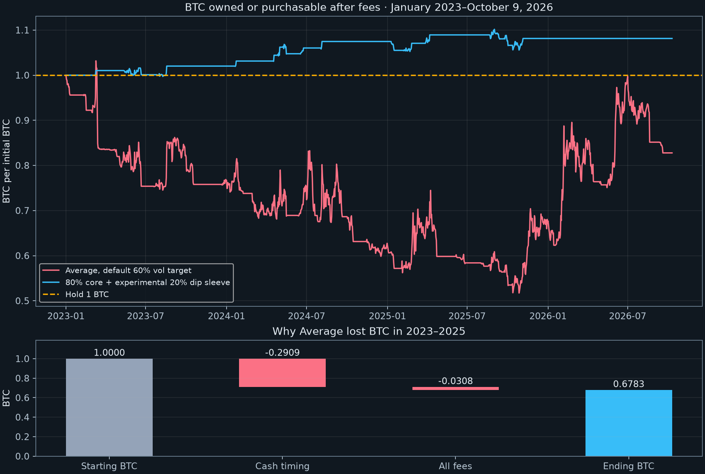

BTC accumulation: loss attribution, 2026 and bull-market alternatives
=====================================================================

Audit: 10 October 2026. Data ends **10 October 2026 00:00 UTC, exclusive**, covering completed bars through October 9. This is a partial-year 2026 test, not a full-year result. Dollar prices are Binance BTC/USDT; USDT is treated as dollar cash without modeling a depeg.

**Answer:** Average benefited from the 2026 decline, but including it does not repair the 2023–2025 BTC shortfall. A fresh 1 BTC on January 1, 2026 becomes **1.217856 BTC**. The continuous January 2023 portfolio ends at **0.827757 BTC**, still **17.22% behind holding**. Bear-market gains can compensate for bull-market opportunity cost in some windows: the 2019–October 2026 run ends at **1.5223 BTC**. That depends heavily on the starting period and is not evidence of reliable accumulation in every regime.

Why BTC was lost
---------------

The exact 2023–2025 reconciliation per original BTC is:

`1 − 0.290857490 cash-timing loss − 0.030138515 trading fees − 0.000678326 ending conversion fee = 0.678325670 BTC`

About **90.4% of the shortfall was cash timing**, and **9.6% fees**. This is a within-ledger accounting decomposition, not a hypothetical zero-fee strategy return. Fees can also affect later trades and compounding.

Holding BTC leaves BTC units constant. Holding cash changes its BTC purchasing power whenever price changes. The backtest measures those changes both across each open and from that open to its close. Trading fees are measured in BTC at each fill; ending cash is converted at the final close including its purchase fee. The resulting identity is checked to numerical tolerance for every detailed run.

The original model sells as trends weaken, often stays underinvested during a rally, and waits for trend recovery before repurchasing. That helped dollar drawdowns, but did not reliably sell higher than it repurchased over the full period. Important examples:

- March–April 2023: the March 1–April 27 interval with cash exposure contributed approximately **−0.1004 BTC** from cash timing alone. This interval includes partial resizing, not a single all-in/all-out trade.
- February–May 2024: elevated funding triggered an early trim while BTC was still around $57k. The rally continued toward $74k. The February 28–May 16 cash-exposure interval cost approximately **0.0473 BTC** in net timing despite the subsequent correction.
- August 2024: the final exit was near $61,498 before the $49k low, but the original strategy repurchased near $62,948 on September 20. Successfully avoiding the worst fall did not make that final exit/re-entry pair BTC-positive after fees.
- February–April 2025 worked better: final exit near $97,370, re-entry near $93,443. The continued 2025 run gained BTC overall, but could not recover the 2023–2024 deficit.

The continuous portfolio's year-end BTC purchasing power, without resetting holdings or injecting funds:

| Through | BTC equivalent |
| --- | ---: |
| 2023 | 0.7668 |
| 2024 | 0.6226 |
| 2025 | 0.6783 |
| 2026 | 0.8278 |

The 2026 row ends October 9. Annual marks include hypothetical cash-conversion fees for reporting; cash is not actually converted at every year-end. Thus multiplying separately restarted annual tests is not the continuous portfolio ledger.

Removing the funding trim changes 2023–2025 ending BTC from 0.6783 to **0.6877**; removing staged sizing, funding and volatility sizing together in the binary comparison yields **0.7016**. Neither repairs the loss. In the previous audit, full-size spot and the default volatility target had almost identical recent performance. The central issue is trend-exit/re-entry opportunity cost, not one funding threshold or the 60% volatility target alone.

2026 helps because sustained downtrends reward cash
--------------------------------------------------

In the fresh 2026 test, Average's cash timing adds **0.226549 BTC**, while trading fees consume **0.008693 BTC**, yielding 1.217856 BTC. Its worst dollar drawdown at 4h closes is **8.03%**, versus approximately **39.98%** for holding BTC. It still whipsaws: the January 1 opening sale near $87,648 was followed by a January 14 buy near $95,414.

Later exits and re-entries were productive: full exit January 21 near $88,428 followed by buying April 14 near $74,546; full exit May 18 near $77,074 followed by buying August 20 near $69,335. Earlier partial reductions and subsequent trades are included in the reported totals. The entire year's result is not inferred from those two favorable pairs.

Fixed alternatives, not an optimized threshold search
----------------------------------------------------

Every cell below starts with **1 BTC at that window's start**. All cash is counted as fee-net purchasable BTC at the end. No deposits, leverage, cash yield or perpetual funding payments. The spot strategy uses funding only as a signal. Fee: **0.10% per side**. Decisions use completed bars, with fills at the following 4h open. Dollar drawdowns use 4h closes, which can miss worse intrabar losses. Spread, slippage, taxes and exchange/custody risks are not in the base ledger.

| Model | 2020–2021 | 2022 | 2023–2025 | 2026 through Oct 9 | Jan 2023–Oct 9, 2026 |
| --- | ---: | ---: | ---: | ---: | ---: |
| Hold BTC | 1.0000 | 1.0000 | 1.0000 | 1.0000 | 1.0000 |
| Average, default 60% vol target | 0.6622 | 2.5039 | 0.6783 | 1.2179 | 0.8278 |
| Average without funding trim | 0.7460 | 2.5039 | 0.6877 | 1.2179 | 0.8392 |
| Full in/out at >60% / <40% | 0.8734 | 2.4307 | 0.7016 | 1.2040 | 0.8464 |
| Buffered daily SMA200 only | 0.4479 | 2.7650 | 0.4060 | 1.1166 | 0.4543 |
| Hold in SMA200 bull; Average otherwise | 0.5828 | 2.4830 | 0.5322 | 1.2528 | 0.6680 |
| 80% core + experimental 20% dip sleeve | 0.9780 | 1.0000 | 1.0814 | 1.0000 | 1.0814 |

These seven models were specified before viewing this run's outputs; no grid search was performed. However, the original strategy and historical episodes had already been examined. This is exploratory model selection on reused history, **not an untouched holdout or a forward test**. The 2023–2025 interval includes declining periods; calendar labels never feed the trade rules.

The SMA200 regime turns on after two successive daily closes >102% of the current daily SMA200, and turns off after two successive daily closes <98% of it; otherwise it retains state, initially off. The standalone model is full BTC when on and cash when off. The hybrid uses full BTC when on and the original Average target otherwise. Both disappointing results are retained: merely adding a slow regime switch did not solve the accumulation problem.

Promising recent candidate: preserve the core, buy back the sleeve sooner
-----------------------------------------------------------------------

The experimental dip sleeve has these exact rules:

1. Keep **0.8 of the original BTC units** untouched. Start with the remaining **0.2 BTC** invested. Never transfer from or rebalance the core.
2. While the buffered SMA200 regime described above is on, sell the entire current sleeve after the closed 4h ensemble crosses from at least 40% to below 40%. Execute at the next open. Starting mid-signal does not create an immediate sale; a new crossing is required.
3. Buy back the sleeve at the next open after either a close reaches `sale_price × (1 − fee) / ((1 + fee) × 1.05)`, or the ensemble exceeds 60%, whichever occurs first. The first condition seeks **5% more sleeve BTC**, not 5% more total portfolio BTC. Gaps can change the realized result.
4. A new crossing below 40% can trigger another sale while the slow regime is on; no recovery above 60% is needed to re-arm. While cash remains from an earlier sale, the buyback rules remain active even if the regime turns off. New sales are disabled while the slow regime is off.
5. No funding trim, volatility sizing, shorting or leverage in this sleeve.

The structural difference is the explicit buyback hurdle: it can repurchase after a meaningful dip rather than wait for a strong trend recovery. It still buys higher after false breakdowns. In 2023–2025 it completed **17 round trips, 11 positive and 6 negative**, growing the sleeve from 0.2 to 0.281382 BTC, for **1.081382 BTC total**. Independent sale/buy price-ratio compounding matches the cash ledger exactly.

It does not capture entire crashes. It repurchased on August 5, 2024 near **$58,161**, before the $49k low. After selling February 5, 2025 near **$97,370**, it repurchased February 25 near **$91,552**, before the later $77k/$74.5k lows. It earns BTC from a smaller move while remaining exposed to later price losses.

Sensitivity and failure cases
-----------------------------

Eight bar/day alignments, offset by 0, 3, 6, 9, 12, 15, 18 and 21 hours; fee 0.10% per side:

| Dip-sleeve window | Mean ending BTC | Range | Alignments >1 BTC |
| --- | ---: | ---: | ---: |
| 2020-21 | 0.9973 | 0.9459–1.0326 | 5/8 |
| 2019-22 | 1.0236 | 0.9670–1.0645 | 6/8 |
| 2023-25 | 1.0925 | 1.0513–1.1520 | 8/8 |
| 2023-26 | 1.0925 | 1.0513–1.1520 | 8/8 |
| 2019-26 | 1.1244 | 1.0748–1.2137 | 8/8 |

Recent gains survive all eight alignments, but **2020–2021 does not show a dependable accumulation edge**: the page alignment ends at 0.9780 BTC and the alignment average is 0.9973 BTC. At 0.60% fees per side, its 2020–2021 eight-alignment mean falls to about **0.9746 BTC**; the 2019–2022 mean falls to **0.9899 BTC**. This is not a universal bull-market solution.

Cost and execution-delay stress for the sleeve, January 2023–October 9, 2026, page alignment:

| Fee per side | Normal next-open fill | One additional 4h bar of delay |
| --- | ---: | ---: |
| 0.10% | 1.0814 | 1.1097 |
| 0.30% | 1.0761 | 1.1056 |
| 0.60% | 1.0657 | 1.0764 |

The higher fees are a cost stress, not an explicit order-book slippage model. Additional delay sometimes improves results, so it is sensitivity evidence rather than a worst-case execution guarantee. At 0.60% fees, the recent eight-alignment mean remains approximately **1.0467 BTC**.

Starting each month January 2019–October 2025, the candidate beat holding in **54/82** overlapping 12-month windows, median **1.0194 BTC**, worst **0.9460 BTC**. Average won 36/82, median 0.9282 BTC. These windows overlap substantially and do not provide independent probabilities of success.

**Dollar risk remains large.** The sleeve made no trades during 2026 in these tests and held 1 BTC throughout. Its 2026 dollar drawdown was approximately **40%**, versus **8%** for Average. The continuous 2023–October 2026 sleeve portfolio had a **53.0%** dollar drawdown, versus **21.4%** for Average. Its older 2019–2022 dollar drawdown was approximately **76.5%**. Keeping BTC and protecting dollar wealth are different objectives; the fixed core intentionally remains exposed.

Noise and warning signals
-------------------------

The [earlier correction audit](REPORT.md) tested alerts explicitly. Sub-60% breadth produced 19 episodes, of which 7 preceded an additional 10% fall within 30 days. Requiring two daily closes below SMA50 reduced that to 16 episodes with 6 hits: fewer interruptions, almost unchanged precision. Funding above 15% had 0/3 hits under that definition. Samples are small and overlapping.

Therefore no tested warning cleanly predicts both crashes without noise. The sleeve uses existing trend deterioration as a trigger, limits the amount exposed to a false sale, and defines a buyback rule. Its favorable recent outcome does not establish that the warning itself predicts crashes. The new SMA200 filter has not been isolated in a matched sleeve ablation, so this study cannot attribute the sleeve's improvement specifically to that filter rather than to its sizing, triggers and buyback rule jointly.

Data, verification and reproduction
----------------------------------

- Original cached Binance hourly/4h history and funding fixture documented in [the original audit](REPORT.md); historical JS signals and independent Python arrays match. The latest production replay contains **20,029 4h bars**.
- Public [Binance spot candle endpoint](https://api.binance.com/api/v3/klines?symbol=BTCUSDT&interval=4h&startTime=1790467200000&endTime=1791590399999&limit=1000) and [funding history endpoint](https://fapi.binance.com/fapi/v1/fundingRate?symbol=BTCUSDT&startTime=1788998400000&endTime=1791590400000&limit=1000) extend the cache through October 9. Exact requested sources and raw responses are in `extension-2026.json`. Seven overlapping 4h candles matched before appending; all recent 4h timestamps are continuous.
- The hourly cache omits **2023-03-24 13:00 UTC**. No price was fabricated. All default 4h bars remain present; alternate alignments inherit this source limitation. Earlier historical gaps are also preserved by the existing grid implementation.
- Two truncated-history checks verify unchanged earlier candidate signal arrays; the original replay also matches the production fixture. Core-floor and nonnegative-cash assertions execute throughout all simulations.
- `report_2026.py` independently reconstructs each detailed ending balance solely from its fills and final price, checks attribution identities, and checks the recent sleeve's entire 17-pair compounded BTC result.
- Scripts: `fetch_2026.py` → `extend_2026.cjs` → `bull_bear_2026.py` → `accumulation.py` → `report_2026.py`. The Python research requires the existing adjacent `quant/research_notes/ensemble_v2/core.py`, cached hourly history and original fixture; it is not a standalone data download for the entire period. `export.cjs` creates the original production replay if absent.
- Outputs: `bull-bear-2026-results.json` contains all variants, alignments, fee tests, detailed page-alignment fills, annual attribution and curves. The page's default historical comparison remains Average; the dip sleeve is clearly experimental and does not replace the live model.

Recent sleeve round trips
-------------------------

Times UTC. Gain is on sleeve BTC after both 0.10% fees, not on total portfolio BTC.

| Sale time | Sale price | Buy time | Buy price | Sleeve BTC change |
| --- | ---: | --- | ---: | ---: |
| 2023-03-08 08:00 | $21,971.83 | 2023-03-09 20:00 | $20,856.30 | +5.14% |
| 2023-05-13 00:00 | $26,795.01 | 2023-05-30 00:00 | $27,736.39 | -3.59% |
| 2023-06-02 00:00 | $26,817.93 | 2023-06-15 00:00 | $25,128.60 | +6.51% |
| 2023-06-19 04:00 | $26,403.36 | 2023-06-21 00:00 | $28,308.00 | -6.91% |
| 2023-07-28 00:00 | $29,222.78 | 2023-08-18 00:00 | $26,623.41 | +9.54% |
| 2024-01-20 00:00 | $41,659.03 | 2024-01-23 00:00 | $39,568.02 | +5.07% |
| 2024-04-17 00:00 | $63,793.40 | 2024-04-17 16:00 | $60,304.95 | +5.57% |
| 2024-04-27 00:00 | $63,770.00 | 2024-04-30 20:00 | $59,292.95 | +7.34% |
| 2024-05-08 16:00 | $62,273.07 | 2024-05-16 16:00 | $65,818.89 | -5.58% |
| 2024-06-16 00:00 | $66,228.25 | 2024-06-24 04:00 | $62,862.00 | +5.14% |
| 2024-08-03 00:00 | $61,498.34 | 2024-08-05 00:00 | $58,161.00 | +5.53% |
| 2025-01-10 00:00 | $92,552.49 | 2025-01-16 04:00 | $99,478.04 | -7.15% |
| 2025-02-05 20:00 | $97,370.00 | 2025-02-25 00:00 | $91,552.88 | +6.14% |
| 2025-03-28 12:00 | $85,255.25 | 2025-04-06 20:00 | $79,614.34 | +6.87% |
| 2025-08-22 00:00 | $112,500.00 | 2025-09-13 08:00 | $115,778.72 | -3.03% |
| 2025-09-23 00:00 | $112,650.99 | 2025-10-02 08:00 | $118,489.76 | -5.12% |
| 2025-10-12 04:00 | $110,676.00 | 2025-11-04 08:00 | $104,490.73 | +5.71% |
