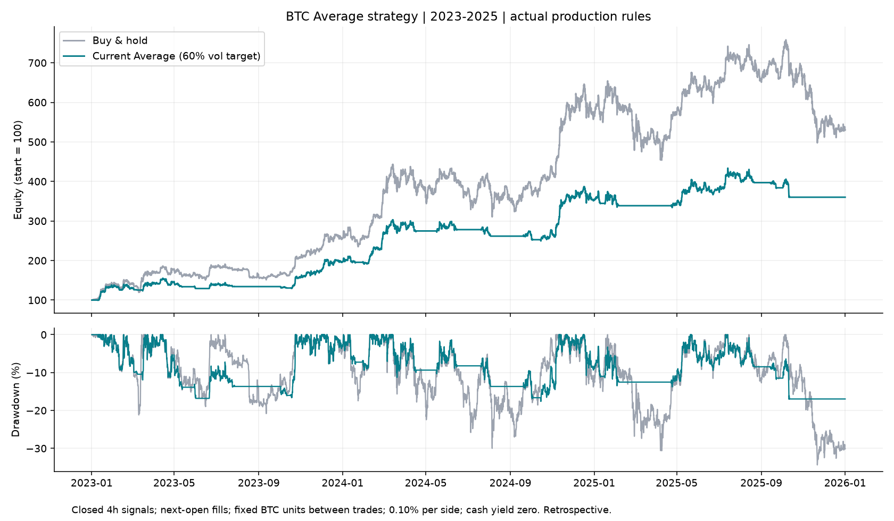
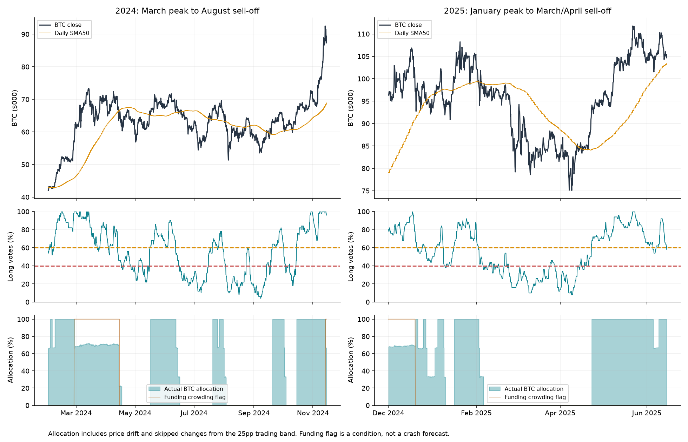

BTC Average strategy: corrections in 2023–2025
=============================================

Research date: 10 October 2026. The production strategy in `btc.html` was read and replayed, not changed. All event and execution times below are UTC. Dollar labels refer to Binance BTC/USDT prices.

The strategy did well at reducing sustained drawdowns, including both requested corrections. It did not maximize bull-market return or anticipate every crash. From January 2023 through December 2025, the default mode returned **+260.1% versus +429.9% for buy-and-hold**, with worst 4h-closing drawdowns of **−17.6% versus −34.4%**. The stronger finding on noise is that the recovery buffer already present in the code sharply reduced repeated resizing. Adding the tested SMA-based defensive overlays made recent results worse.

**What was tested**

The exact current JavaScript was executed on 19,958 cached Binance 4h bars, with earlier history for indicator warmup and continuing portfolio state. The study contains 6,576 uninterrupted bars from 2023-01-01 through 2025-12-31. Votes, buffered levels and all three position arrays matched the pre-existing independent Python fixture. Four production-prefix tests around the focus events verified that adding later observations did not change earlier signals. The existing `btc-average.test.cjs` suite also passed.

Default mode: 60% volatility target, spot only, at most 1×. The 50 votes comprise 36 iMACD, 5 daily SMA, 5 momentum and 4 Donchian members. Entry requires more than 60%; reductions occur below 60% and 50%; complete exit below 40%. Recovery requires 54% or 64% with 50 binary members. These are correlated trend measurements, not 50 independent forecasts; iMACD contributes 72% of the vote.

Funding above 15% annualized over 14 days multiplies desired exposure by two-thirds. The 25-percentage-point band applies to the final desired position, including funding and volatility adjustments; complete exits always execute. Execution uses the next 4h open, fixed BTC units between trades, fees of 0.10% of traded notional per side, and cash yield zero. Funding is a signal only: the spot portfolio does not pay perpetual funding. Spread, slippage, tax and exchange/cash risk are not modeled. Portfolio weights can drift between trades.

**Whole-period performance**

| Period | Average return | Buy & hold return | Average max DD, 4h closes | Buy & hold max DD, 4h closes |
| --- | --- | --- | --- | --- |
| 2023 | +96.3% | +155.6% | -16.8% | -21.2% |
| 2024 | +79.7% | +121.3% | -17.6% | -30.0% |
| 2025 | +2.1% | -6.3% | -17.1% | -34.4% |
| 2023-2025 | +260.1% | +429.9% | -17.6% | -34.4% |

Three-year CAGR was 53.3% versus 74.3%. The strategy averaged approximately 51% BTC exposure and made 94 rebalances. All three sizing modes were nearly identical in this window: full-size spot returned +261.1%, versus +260.1% for the default; the default and full-size paths were effectively identical in 2024 and 2025. The staged trend exposure did most of the work; the 60% volatility target was not a special crash predictor. At 0.30% and 0.60% fees per side, default three-year returns fell to +231.3% and +192.3%, respectively.

**The $70k → $50k correction: several failed recoveries, not one straight fall**

Binance’s intraday high was $73,777 on 14 March 2024; the low was $49,000 on 5 August, a 33.6% decline. At the March peak the strategy still had 98% long votes. Its funding reading was already elevated at 53.7% annualized, with a two-thirds target and approximately 72% actual exposure after price drift. There was no trend signal identifying the top.

The first fast March decline was a weak spot: the 15.7% closing-price drop through 20 March cost the strategy 11.3%, with no new rebalance during that swing. Funding reduced the damage but did not predict the timing. On 23 March the vote fell to 58%, yet the desired position of 43.1% differed from the last target of 66.7% by only 23.5 percentage points. The 25pp band therefore blocked that additional sale. This is a real example where a visible deterioration did not translate into a trade.

The subsequent path shows why the whole correction should be studied, including re-entries:

| Execution UTC | BTC price | New target |
| --- | --- | --- |
| 2024-04-14 00:00 | $63,925 | 22.2% |
| 2024-04-17 00:00 | $63,793 | 0.0% |
| 2024-05-16 16:00 | $65,819 | 100.0% |
| 2024-06-12 00:00 | $67,314 | 66.7% |
| 2024-06-14 00:00 | $66,773 | 33.3% |
| 2024-06-16 00:00 | $66,228 | 0.0% |
| 2024-07-20 00:00 | $66,660 | 100.0% |
| 2024-07-25 04:00 | $64,094 | 66.7% |
| 2024-07-26 20:00 | $67,990 | 100.0% |
| 2024-07-31 00:00 | $66,188 | 66.7% |
| 2024-08-01 00:00 | $64,628 | 33.3% |
| 2024-08-03 00:00 | $61,498 | 0.0% |

The July 31 reduction, August 1 reduction and August 3 complete exit occurred before the August 5 crash. The final July 29–August 5 closing-price leg was −26.2% for BTC and −8.0% for the strategy. Across the full March peak to August intraday low, marking both portfolios at those same BTC prices, BTC lost 33.6% and the strategy approximately 14.0%. This includes the intervening May and July re-entries. Using closes of the bars containing those intraday extrema gives −28.1% and −13.6%; these are distinct conventions, not interchangeable drawdown estimates.

The cost of being cautious was a late re-entry: 20 September at $62,948, far above the $49k low. The strategy did avoid the renewed August–September sell-off while it waited. Glassnode’s contemporary [Mid-Cycle Wipeout](https://research.glassnode.com/the-week-onchain-week-32-2024/) describes the leverage reset and short-term-holder stress during the August sell-off; those observations corroborate the event, but are not advance inputs to this backtest.

**The $109k → $77k correction: a successful sustained-trend exit**

Binance reached $109,588 on 20 January 2025 and $76,606 on 11 March, a 30.1% intraday decline. The correction continued to $74,508 on 7 April, making the full fall 32.0%. At the January peak the vote was 84% long, the strategy was fully exposed, and annualized 14-day funding was only 7.7%: the crowding warning was absent.

| Execution UTC | BTC price | New target |
| --- | --- | --- |
| 2025-02-02 12:00 | $98,865 | 66.7% |
| 2025-02-03 00:00 | $97,701 | 33.3% |
| 2025-02-05 20:00 | $97,370 | 0.0% |

It remained flat through both the March and April lows. Marked at the January intraday peak and either intraday trough, the strategy lost approximately 10.7%, versus BTC’s 30.1%/32.0%. From the close of the January peak bar, its loss was 8.6%; the same-window maximum closing-equity drawdown was 10.6%, because the portfolio briefly recovered between those dates. This was an exit after initial damage, well before the larger decline, rather than a forecast of the $109k top.

The first re-entry was 23 April at $93,443, around 25% above the April low but below the $97,370 final exit. That missed rebound is part of the price of trend confirmation. Contemporary [Tariffs and Turmoil](https://research.glassnode.com/the-week-onchain-week-14-2025/) confirms the April extension to approximately $74.5k and describes the failure to reclaim support. Its on-chain discussion was published during the correction; it is not evidence that such data would have provided a cleaner earlier exit than this strategy.

**Every major correction under an explicit definition**

The following is the complete inventory of alternating swings of at least 15% in 4h closing prices during the study. A down-leg ends when price rises 15% from its running trough. This retrospective rule defines the event table only; it never feeds the strategy. The table compares the portfolio’s change over the exact same peak-close to trough-close interval, not each portfolio’s separately selected maximum drawdown. The last event is included through year-end even without a qualifying recovery; later 2025 is not assumed to remain a bull regime. Smaller 10% swings appear below.

| BTC peak → trough | BTC return | Average return | First flat decision/fill time UTC |
| --- | --- | --- | --- |
| 2023-02-16 → 2023-03-10 | -21.2% | -10.4% | 2023-03-08 08:00 |
| 2023-04-14 → 2023-06-15 | -19.0% | -16.8% | 2023-05-13 00:00 |
| 2023-07-13 → 2023-09-11 | -20.8% | -7.0% | 2023-07-28 00:00 |
| 2024-01-11 → 2024-01-23 | -17.5% | -7.3% | 2024-01-20 00:00 |
| 2024-03-13 → 2024-03-20 | -15.7% | -11.3% | Not flat in this leg |
| 2024-04-08 → 2024-05-01 | -21.4% | -8.5% | 2024-04-17 00:00 |
| 2024-06-07 → 2024-07-05 | -24.1% | -7.0% | 2024-06-16 00:00 |
| 2024-07-29 → 2024-08-05 | -26.2% | -8.0% | 2024-08-03 00:00 |
| 2024-08-24 → 2024-09-06 | -16.8% | +0.0% | 2024-08-24 08:00 |
| 2025-01-20 → 2025-02-28 | -26.8% | -9.6% | 2025-02-05 20:00 |
| 2025-03-03 → 2025-04-09 | -20.4% | +0.0% | 2025-03-03 00:00 |
| 2025-10-06 → 2025-11-21 | -34.4% | -11.3% | 2025-10-12 04:00 |

The principal failures are visible in that table. April–June 2023 generated 13 rebalances and repeated false recoveries: the strategy lost 16.8% against BTC’s 19.0%, so protection was limited. July–September 2023 was much better: it was flat from 28 July, before the 17 August flash decline. March 2024 moved too quickly for new trend reductions. The October–November 2025 decline was eventually limited to an 11.3% closing-interval loss, but that conceals its initial shock exposure.

On **10 October 2025, 20:00 UTC**, the strategy entered the 4h bar fully invested, with 78% long votes at the preceding close. BTC fell from a bar open of $116,661.50 to $102,000 intrabar. The strategy’s worst estimated intrabar peak-to-trough drawdown over the entire study was **24.2%**, compared with 17.6% at 4h closes. The OHLC-based intrabar measure is a conservative bound when a bar’s high/low ordering is unknown. Close-only indicators cannot guarantee an exit before an abrupt within-bar shock.

**Warnings and false alarms**

Six fixed warning definitions were compared without searching threshold grids. A new alert starts when its condition is true, and re-arms only after seven continuous days without that condition. A “hit” means an additional 10% decline in 4h closing prices from the next-open execution price within 30 days. The final 30 days are excluded so every alert has a complete outcome window. An initial already-active condition is counted. This is a demanding crash-timing test, not a claim that other alerts have no risk-management value.

| Warning | Alert episodes | Further 10% fall within 30 days | Time condition active |
| --- | --- | --- | --- |
| Funding >15% | 3 | 0/3 (0.0%) | 9.9% |
| Ensemble <60% | 19 | 7/19 (36.8%) | 50.7% |
| Ensemble <50% | 17 | 6/17 (35.3%) | 41.7% |
| Two daily closes <SMA20 and E<60% | 27 | 8/27 (29.6%) | 36.3% |
| Two daily closes <SMA50 and E<60% | 16 | 6/16 (37.5%) | 36.5% |
| E falls 20pp in 3d, below 60% | 27 | 8/27 (29.6%) | 5.4% |

For context, 29.6% of all eligible UTC daily observations experienced a further 10% decline within 30 days. That daily base rate is not a matched independent control: alert episodes and outcome windows overlap, sample sizes are small, and no statistical significance is established. The SMA50 confirmation produced fewer episodes than an unconfirmed sub-60% vote, but its 6/16 hit rate was barely different from 7/19. It mainly reduces interruptions by waiting. The faster SMA20 and rapid-vote-drop warnings did not improve precision.

Funding is better treated as a vulnerability condition than a crash clock. Its February 2024 alert began around $57,037; BTC subsequently rose almost 29% above that level within the next 30 days. The warning was still useful for carrying less exposure at the March top. It was absent before the August 2024 crash and the January–April 2025 decline. Removing funding trim increased recent return slightly (+265.1% versus +260.1%) but worsened maximum closing drawdown to 22.8% from 17.6%. That is support for a risk trim, not an all-out sell signal.

A daily SMA50 confirmation was later than the existing trend exit in February 2025: it fired on 6 February at about $96,612, after the strategy was already out. Therefore, adding it as a prerequisite for reducing risk would have delayed the successful exit. Simply combining more related trend indicators does not establish new independent predictive information.

**Would an added defensive overlay improve the strategy?**

Two fully specified overlays were tested: after two daily closes below SMA20 or SMA50 and E<60%, cap desired exposure at one-third; release only after two closes above that same average and E≥64%. Apply this before the existing 25pp band; exits retain priority. These overlays persist across temporary rebounds, so they test an implementable rule rather than isolated visual signals.

| Rule, page alignment | 2023–25 return | Max DD at 4h closes | Rebalances | Opposite changes ≤24h |
| --- | --- | --- | --- | --- |
| SMA20 confirmed cap 1/3 | +212.1% | -21.7% | 90 | 0 |
| SMA50 confirmed cap 1/3 | +230.9% | -18.7% | 93 | 1 |
| Current | +260.1% | -17.6% | 94 | 2 |
| No funding trim | +265.1% | -22.8% | 98 | 2 |
| Without existing 3pp recovery buffer | +259.8% | -17.1% | 112 | 22 |

The **existing 3pp recovery buffer** reduced changes from 112 to 94 and rapid opposite changes from 22 to 2, with three-year return virtually unchanged (+259.8% to +260.1%). Its single-alignment maximum closing drawdown was slightly worse, so it is a noise improvement rather than a universal improvement in all metrics. Adding the SMA caps reduced some noise further but worsened both recent return and drawdown.

An independent Python replay repeated the comparison using eight candle/day offsets: 0, 3, 6, 9, 12, 15, 18 and 21 hours. Funding publication times remained in real UTC. Phase zero exactly reproduced the production position array. Values below are means of separate metrics, not a portfolio of eight systems.

| Rule, eight-offset mean | 2023–25 CAGR | Max DD at 4h closes | Changes over 3y | Rapid reversals over 3y |
| --- | --- | --- | --- | --- |
| Current | +51.9% | -19.1% | 91.5 | 3.9 |
| No recovery buffer | +51.2% | -19.5% | 110.2 | 19.6 |
| No funding trim | +52.6% | -24.0% | 95.0 | 4.1 |
| SMA20 cap | +44.1% | -21.9% | 90.6 | 1.5 |
| SMA50 cap | +47.0% | -19.4% | 92.0 | 1.8 |

The default’s CAGR ranged from 45.6% to 56.7% across offsets, which is material timing sensitivity. The SMA caps helped in the earlier 2019–2022 comparison but harmed 2023–2025; that is regime dependence, not a robust recent upgrade. Eight offsets are not eight independent market histories.

**Recommended interpretation and alert design**

Keep the tested production execution rules for now. Use the ensemble’s existing deterioration as the main actionable information: below 60% means broadening weakness, below 50% means more severe loss of trend participation, and below 40% means exit. Preserve immediate risk reductions and the asymmetric recovery buffer. Do not smooth all signals or require daily confirmation before allowing the current exits based on this evidence.

If an explanatory warning display is added later, show three separate facts: (1) funding crowding, (2) current vote/step and whether the position has actually changed, and (3) optional confirmation from two daily closes below SMA50. Label the last one “confirmed trend damage,” not “crash predicted.” Deduplicate notifications by state transition and show a single ongoing episode rather than repeating a warning every 4h. A notification policy has not been deployed or assessed for user response. In particular, expose any reduction skipped by the 25pp band so the user can distinguish a warning from an executed target.

Do not use an ATH touch, an overbought RSI, a visually identified lower high, low volatility alone, or the page’s estimated liquidation heatmap as a validated sell trigger. They were not established as incremental predictors by this audit. A proper next research step for outside information would require point-in-time, publication-lagged ETF-flow/open-interest/options/on-chain data and testing added value beyond the existing ensemble. Contemporary reporting alone cannot supply that validation.

These are reconstructed historical results using rules developed after these years. The surrounding research has already explored hundreds of variants; neither 2023–2025 nor 2019–2022 is an untouched holdout. The new comparison is bounded, but remains retrospective and selected around known events. No inference here establishes future returns or reliably identifies every crash. The original page’s “2023+” snapshot extends into September 2026 and should not be substituted for this three-calendar-year result.

**Complete smaller-correction inventory: 10% closing-price swings**

Same alternating-swing definition with 10% in both directions. This splits some long corrections into multiple legs. Intraday-only falls that never reach 10% at a 4h close are excluded; dates alone can conceal intraday swings. Returns are not additive across rows.

| Peak close UTC | Trough close UTC | BTC return | Average return |
| --- | --- | --- | --- |
| 2023-02-16 16:00 | 2023-03-10 12:00 | -21.2% | -10.4% |
| 2023-04-14 12:00 | 2023-06-15 16:00 | -19.0% | -16.8% |
| 2023-07-13 20:00 | 2023-09-11 20:00 | -20.8% | -7.0% |
| 2024-01-11 12:00 | 2024-01-23 12:00 | -17.5% | -7.3% |
| 2024-03-05 00:00 | 2024-03-05 20:00 | -10.0% | -7.1% |
| 2024-03-13 20:00 | 2024-03-20 04:00 | -15.7% | -11.3% |
| 2024-04-08 12:00 | 2024-04-17 16:00 | -16.7% | -8.5% |
| 2024-04-23 00:00 | 2024-05-01 16:00 | -14.9% | +0.0% |
| 2024-06-07 12:00 | 2024-07-05 08:00 | -24.1% | -7.0% |
| 2024-07-29 12:00 | 2024-08-05 12:00 | -26.2% | -8.0% |
| 2024-08-24 08:00 | 2024-09-06 20:00 | -16.8% | +0.0% |
| 2024-12-17 04:00 | 2024-12-30 16:00 | -13.8% | -9.3% |
| 2025-01-07 00:00 | 2025-01-13 12:00 | -11.1% | -8.2% |
| 2025-01-20 12:00 | 2025-02-28 08:00 | -26.8% | -9.6% |
| 2025-03-03 00:00 | 2025-03-04 16:00 | -12.0% | +0.0% |
| 2025-03-06 04:00 | 2025-03-11 00:00 | -14.2% | +0.0% |
| 2025-03-24 16:00 | 2025-04-09 04:00 | -15.0% | +0.0% |
| 2025-05-22 04:00 | 2025-06-22 20:00 | -11.5% | -9.4% |
| 2025-08-14 04:00 | 2025-09-01 04:00 | -12.7% | -7.8% |
| 2025-10-06 20:00 | 2025-11-21 12:00 | -34.4% | -11.3% |

**Reproduce and inspect**

Run `node export.cjs`, then `python analyze.py`, `python alignments.py`, and `python report.py` from this directory or using their full paths. Python requires NumPy, SciPy and Matplotlib. The export reads the existing adjacent `quant/research_notes/ensemble_v2/runs/r18_verify_20260930T065706Z_3615/fixture.json`; the offset check reads that repository’s cached hourly history and indicator code. No live data download was used. The large intermediate `production.json` is ignored by Git.

Outputs: [full results](results.json), [eight-offset results](alignments.json), [executed trades](trades-2023-2025.csv), [equity chart](equity.png), and [focus-event chart](focus-corrections.png). `export.cjs` extracts the source functions directly rather than substituting a research approximation. `alignments.py` provides independent Python parity at phase zero.

Production `btc.html` SHA-256: `149bbd4308eb53fc5a7f7e66485c83a91e7ddcc8b50d9dfd90ecc30125881072`.