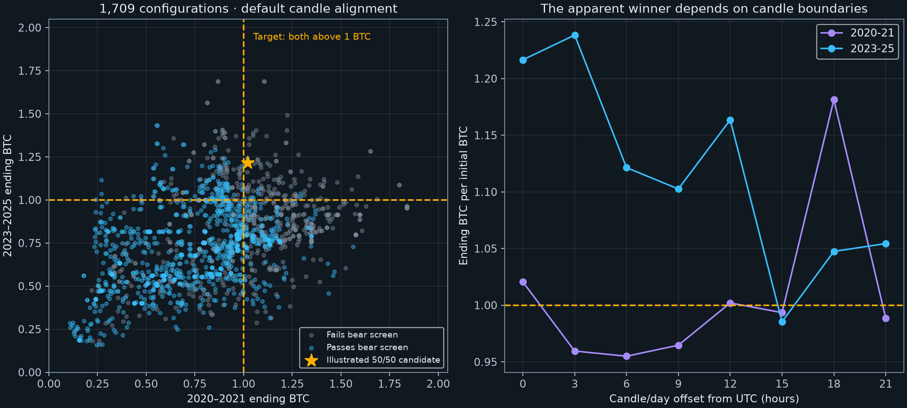

Expanded BTC strategy search: larger gains, bull cycles and bear defense
=======================================================================

Completed **11 October 2026**. The price sample stays frozen through **9 October 2026 UTC**, matching the earlier audit. 2026 is a partial year. All results are calculations on cached Bitstamp/Binance prices, with Coin Metrics MVRV in the final batch; they are not returns copied from published studies.

**Finding:** the earlier 20% sleeve was too narrow a search for the requested goal. Expanding to **1,709 configurations** found larger BTC gains and nine base-case combinations that added BTC in both requested bull periods and both bear periods while reducing bear drawdowns. **None of those nine passed the complete screen across all eight candle alignments.** No strategy is established here as a dependable way to avoid BTC losses and bear-market losses simultaneously.

The counts are configurations, not independent discoveries: some settings generate identical signals, and the families overlap. The search was adaptive and reused already examined history. The nine base-case successes are selected in sample.

What was searched
-----------------

| Batch | Configurations | Base-case passes |
| --- | ---: | ---: |
| MA bands/crossovers, breakouts, momentum, ATR stops, RSI, ensemble thresholds and buybacks | 335 | 0 |
| Bull dip trading plus separate bear exits | 672 | 0 |
| Fixed independent dip/defense accounts | 480 | 9 |
| Delayed MVRV valuation, momentum and price confirmation | 222 | 0 |
| Total | 1,709 | 9 |

The full grid and order of experiments are recorded in [PROTOCOL.md](PROTOCOL.md). The base screen required more than 1 BTC from a fresh 1 BTC in **2020–2021, 2023–2025, 2022 and 2026 through October 9**. In each bear window it also required dollar drawdown no worse than **75% of holding's drawdown magnitude**. This is a minimum improvement screen, not zero loss or a claim that 40% drawdown is acceptable to the user. A stricter bear-loss ceiling would reject more candidates.

All accounts are spot/cash only, without leverage, shorts, deposits or cash yield. Fees are 0.10% each side, including any opening sale from the starting BTC and final cash-to-BTC purchase. Every signal uses closed bars and trades at the next 4h open. Costs of opposing trades in separate accounts are charged separately rather than assumed to net for free. Spread, order-book slippage, taxes and cash/venue risks are excluded from the base model.

The larger result and the cost of protecting against bears
---------------------------------------------------------

A full-position dip model with a 10% BTC buyback hurdle produced **1.6882 BTC in 2023–2025** and **1.1052 BTC in 2020–2021**. This is much larger than the original 20% sleeve result. However, its 2022 dollar drawdown remained approximately **67%**, and its 2026 drawdown approximately **40%**. It fails the bear requirement.

Splitting the initial BTC between that dip model and a separate trend-defense account produces a concrete candidate that passes the default historical screen. It is illustrated because it improves recent BTC accumulation while materially reducing bear exposure, **not because it is a validated optimum**.

Exact candidate: 50% dip account + 50% trend-defense account
----------------------------------------------------------

Allocate 0.5 of the original BTC to each account. Run both accounts independently, with no periodic rebalancing or transfers between them. There is no permanently held core; either account can sell its entire BTC position.

**Dip account:**

1. A bullish regime switches on after two consecutive completed daily closes above 102% of daily SMA200. It switches off after two consecutive daily closes below 98%; retain state in between. Indicators and signal state are warmed on prior history.
2. While bullish, sell the dip account when the existing 50-member ensemble crosses from at least 40% to below 40%. Execute next open.
3. Buy back after the first completed 4h close satisfying either `close <= actual_sale_price × 0.999 / (1.001 × 1.10)` or ensemble breadth >60%. Execute next open. The price hurdle targets 10% more BTC **in that account**, before any execution gap; the account can also buy higher after a false breakdown.
4. A new sub-40% crossing can trigger another sale; there is no requirement to first recover above 60%. Losing the bullish regime does not force a dip-account sale. Existing cash positions continue to use the buyback rules.

**Defense account:**

1. Hold BTC when ensemble breadth exceeds 60%.
2. Move entirely to cash when breadth falls below 50%.
3. Retain state between those thresholds. Execute next open; no intermediate trims, funding filter or volatility sizing.

For a $100,000 dip-account sale, the 10% BTC hurdle is about **$90,727.45** with 0.10% fees per side. It is a closed-bar trigger followed by a market fill, not an assumed limit fill or a promise of a 10% gain.

Each row below starts fresh with **1 BTC** at that window's start. Ending cash is fully counted after conversion fees. Continuous multi-year rows are simulated continuously, rather than multiplying separately reset windows.

| Window | Candidate ending BTC | Candidate dollar max DD | Holding dollar max DD |
| --- | ---: | ---: | ---: |
| 2014-18 | 2.7006 | -66.3% | -83.9% |
| 2019 | 1.1550 | -40.4% | -52.6% |
| 2020-21 | 1.0206 | -42.0% | -56.0% |
| 2022 | 1.7915 | -43.1% | -67.2% |
| 2023-25 | 1.2165 | -28.2% | -34.4% |
| 2026 YTD | 1.1394 | -21.1% | -40.0% |
| 2023-26 | 1.3213 | -42.1% | -53.4% |
| 2019-26 | 2.4413 | -50.7% | -77.0% |

The larger recent result is real within these assumptions: **1.2165 BTC** versus Average's **0.6783 BTC** for 2023–2025. The continuous January 2023–October 9, 2026 candidate ends at **1.3213 BTC**, versus Average's **0.8278 BTC**. But the bear drawdowns remain substantial: **43.1% in 2022** and **21.1% in 2026**. The continuous 2019–October 2026 candidate suffers a **50.7%** dollar drawdown. This cannot be described as a strategy that does not suffer in bears.

Why it still fails dependable validation
----------------------------------------

- It passes the whole bull/bear screen on only **3 of 8** candle/day alignments. Across alignments, 2020–2021 ending BTC ranges from **0.9550 to 1.1814**; 2023–2025 ranges from **0.9854 to 1.2384**. A model whose old bull-market gain vanishes when the daily close moves is not a proven solution.
- Raising per-side cost to 0.30% turns the default 2020–2021 result into **0.9756 BTC**. At 0.60%, it becomes **0.9119 BTC**.
- A 24-hour additional execution delay also loses BTC in 2020–2021. Delay means applying the signal later; the buyback hurdle itself remains the frozen base signal and is not re-optimized for delayed fills. This is signal-delay sensitivity, not a complete simulation of a trader recomputing every order from their delayed sale price.
- It beats holding in **55/82** overlapping 12-month windows, median **1.1150 BTC**, worst **0.7351 BTC**. Overlapping windows are not independent trials or a future win probability.
- Its two-year bull-period gain hides losing individual years. The annual rows below restart with 1 BTC; they are not changes in the continuous portfolio balance.

| Fresh annual test | Ending BTC | Dollar max DD |
| --- | ---: | ---: |
| 2019 | 1.1550 | -40.4% |
| 2020 | 0.8266 | -34.9% |
| 2021 | 1.2415 | -39.9% |
| 2022 | 1.7915 | -43.1% |
| 2023 | 0.9460 | -17.1% |
| 2024 | 1.0892 | -15.7% |
| 2025 | 1.1235 | -25.8% |
| 2026 | 1.1394 | -21.1% |

| Cost per side | Extra signal delay | 2020–2021 BTC | 2023–2025 BTC | Full screen, default alignment |
| --- | ---: | ---: | ---: | --- |
| 0.10% | 0h | 1.0206 | 1.2165 | Pass |
| 0.30% | 0h | 0.9756 | 1.1401 | Fail |
| 0.60% | 0h | 0.9119 | 1.0345 | Fail |
| 0.10% | 4h | 1.0394 | 1.1499 | Pass |
| 0.10% | 24h | 0.9732 | 1.0364 | Fail |

The costs are stress assumptions, not a direct order-book slippage model. Positive results on a delayed setting do not make that setting an execution guarantee.

All nine base-case survivors, including parameter neighbors
---------------------------------------------------------

Every survivor used a 50/50 allocation and the SMA200 bullish regime. No 1/3 or 2/3 dip allocation passed the full base screen. The surviving 5/10/15% hurdles and 20/40/50% breadth triggers are shown rather than concealing unsuccessful neighboring configurations in the full results. The strongest survivor on alignment count passes only **4/8**, and not every survivor is stronger on costs or on older periods.

| ID | Dip trigger / gain | Defense rule | 2020–2021 BTC | 2023–2025 BTC | Complete passes across alignments |
| --- | --- | --- | ---: | ---: | ---: |
| 1 | ensemble0.2 / gain0.05 | ensemble0.6_0.4 | 1.0450 | 1.0171 | 1/8 |
| 2 | ensemble0.2 / gain0.05 | ensemble0.6_0.5 | 1.0763 | 1.0388 | 2/8 |
| 3 | ensemble0.2 / gain0.05 | sma100_band0.02_confirm1 | 1.0754 | 1.0635 | 1/8 |
| 4 | ensemble0.2 / gain0.1 | ensemble0.6_0.5 | 1.2941 | 1.0147 | 4/8 |
| 5 | ensemble0.2 / gain0.1 | sma100_band0.02_confirm1 | 1.2932 | 1.0394 | 3/8 |
| 6 | ensemble0.4 / gain0.1 | ensemble0.6_0.5 | 1.0206 | 1.2165 | 3/8 |
| 7 | ensemble0.4 / gain0.1 | sma100_band0.02_confirm1 | 1.0197 | 1.2413 | 2/8 |
| 8 | ensemble0.4 / gain0.15 | sma100_band0.02_confirm1 | 1.0505 | 1.0103 | 2/8 |
| 9 | ensemble0.5 / gain0.15 | sma100_band0.02_confirm1 | 1.0031 | 1.0140 | 3/8 |

Can we select the winning rule in advance?
----------------------------------------

One explicit chronological test selects each January using only the preceding four complete years. It chooses the highest minimum annual BTC multiple, breaking ties by geometric BTC growth and then fewer trades. Holding is eligible. All 1,709 configurations are in the menu. Remaining cash is converted to BTC at each January rotation before funding the newly chosen accounts, with fees; final cash conversion is also charged.

| Trade year | Worst training-year BTC | Following-year BTC multiple | Cumulative BTC from Jan 2019 |
| --- | ---: | ---: | ---: |
| 2019 | 1.0660 | 0.6843 | 0.6843 |
| 2020 | 1.0344 | 0.5814 | 0.3979 |
| 2021 | 1.0000 | 1.1970 | 0.4762 |
| 2022 | 1.2125 | 2.0837 | 0.9923 |
| 2023 | 1.2125 | 1.0000 | 0.9923 |
| 2024 | 1.0174 | 0.8747 | 0.8679 |
| 2025 | 1.0936 | 0.9441 | 0.8194 |
| 2026 | 1.1111 | 1.0325 | 0.8460 |

The selector ends at **0.8460 BTC**, not above the 1 BTC holding benchmark. This directly demonstrates why choosing a strategy that looks good across past years is insufficient. It tests one defined selection rule, not every possible adaptive system. The candidate library itself was built on already examined history, so even this chronology is not a pristine out-of-sample experiment. There is no live or untouched forward test here, and no multiple-testing-adjusted significance claim.

What the external research contributed
--------------------------------------

- [Corbet and coauthors](https://papers.ssrn.com/sol3/papers.cfm?abstract_id=3454216) study moving-average and trading-range breakouts. Those families motivated the initial grid; their reported returns were not substituted for our BTC accounting.
- [Hudson and Urquhart](https://papers.ssrn.com/sol3/papers.cfm?abstract_id=3387950) test many technical rules with data-snooping controls and report an absence of Bitcoin predictability in their out-of-sample period. A good historical fit therefore needs separate scrutiny.
- [Monash's trend-following study](https://www.monash.edu/__data/assets/pdf_file/0011/3744821/Trend-following-Strategies-for-Crypto-Investors.pdf) compares horizons, trading costs and risk measures. Its dollar-return results are not evidence of BTC accumulation in each of our windows.
- [Coin Metrics defines MVRV](https://github.com/coinmetrics/docs-website/blob/master/asset-metrics/market/capmvrvcur.md) as market capitalization divided by realized capitalization. [Glassnode's discussion](https://research.glassnode.com/mastering-the-mvrv-ratio/) motivates valuation bands. The on-chain batch delayed each daily reading by two days and added price confirmation; **none of 222 variants passed the full screen**. Historical metric revisions are not controlled by that publication lag.

The research supports investigating distinct mechanisms, not claiming that combining enough indicators guarantees an edge. Leverage, derivatives carry, lending yield and external contributions were excluded; they would change both the mandate and the risks rather than establish a stronger spot timing edge.

Verification and reproducibility
--------------------------------

- Prices, original ensemble signals and funding provenance are described in [the preceding audit](../btc-corrections-2023-2025/BULL_BEAR_2026.md). The full-in/out 60/40 control reproduces its **0.7015589595 BTC** 2023–2025 result to numerical tolerance.
- The cached earlier Bitstamp history is rescaled and spliced to Binance by the existing `quant` library. It provides indicator warmup and 2014–2018 tests; older venue/data differences remain a limitation. Source gaps, including the missing 2023-03-24 13:00 UTC hour, are preserved rather than fabricated.
- Completed higher-timeframe ranges exclude unfinished trailing groups. Three prefix checks, including two intraday cutoffs, confirm unchanged earlier selected signals.
- Each component's vectorized results are checked against an independent units/cash fill ledger. This report also independently reconstructs **all 72 detailed blend ledgers** from their time-ordered scaled fills, including fees and ending cash conversion.
- Default prices and histories are frozen. The raw MVRV extension and exact public request URL are in `mvrv-extension.json`; earlier values use the cached Coin Metrics file. A two-day availability lag is assumed conservatively; point-in-time data vintages are unavailable.
- Run `search.py`, `search_hybrid.py`, `search_blend.py`, `search_mvrv.py`, `validate.py`, `supplemental.py`, then `report.py`. The existing adjacent `quant/research_notes/ensemble_v2` code/data and earlier Binance extension are required. `fetch_mvrv.py` obtains the latest public on-chain tail.
- `*-results.json` files retain all tested configurations, failures, stress results, exact candidate fills, rolling windows and the annual selections. The page's live Average implementation is unchanged. No strategy is promoted to live trading on this search.
