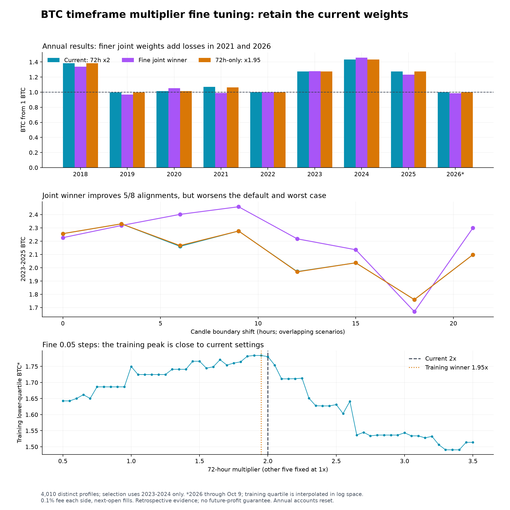

# Fine tuning BTC timeframe multipliers

Completed 19 October 2026. **Decision: retain the live weights [1, 1, 1, 1, 1, 2].** The strongest training-ranked finer profile improves 2023-2024 but weakens several later and older results. Neither shortlisted adjustment passes the predeclared replacement criteria. No chart or Telegram trading rules were changed.

## What was tested

**4,010 distinct profiles × 8 alignments = 32,080 training simulations.** Stage 1 contained 1,826 deduplicated joint-grid/one-axis/control profiles. Stage 2 added 2,184 distinct neighbors around the three training-only leaders. The joint grid used 0.75/1/1.25 for 4h–48h and 1.5–3 in 0.25 steps for 72h; one-axis scans used 0.05 steps, and the second joint pass used ±0.05 for 4h–48h and ±0.10 for 72h. This is a bounded local search, not all real-valued weights.

The ranking maximizes the lower quartile of annualized log BTC in 2023–2024, requiring five round trips in every alignment. Ties prefer proximity to production. The 2025/2026 and other annual results are evaluated after selection. All years have previously been researched, so this is retrospective validation rather than an untouched holdout. The 72% iMACD / 28% daily split, all indicator parameters, sale threshold and buyback rules stay fixed.

| Profile | Multipliers: 4h, 8h, 12h, 24h, 48h, 72h | Training score |
|---|---|---:|
| Current: 72h x2 | 1, 1, 1, 1, 1, 2 | 0.288443 |
| Fine joint winner | 1, 1.25, 1.25, 0.7, 0.7, 2 | 0.306037 |
| 72h-only: x1.95 | 1, 1, 1, 1, 1, 1.95 | 0.289433 |

Fine winner total breadth shares: 4h 10.43%, 8h 13.04%, 12h 13.04%, 24h 7.30%, 48h 7.30%, 72h 20.87%. Daily indicators retain 28%.

## Every year and continuous windows

Each annual account starts with 1 BTC. Continuous windows carry positions across years. * = ending cash valued as purchasable BTC after the buy fee. 2026 ends October 9, matching the frozen dataset used in the original study.

| Window | Current 2× | Fine joint | 72h 1.95× | Previous equal |
|---|---:|---:|---:|---:|
| 2018 | 1.3843 | 1.3388 | 1.3843 | 1.1493 |
| 2019 | 0.9970 | 0.9667 | 0.9970 | 0.9977 |
| 2020 | 1.0135 | 1.0525 | 1.0135 | 0.9646 |
| 2021 | 1.0694 | 0.9886 | 1.0642 | 0.9646 |
| 2022 | 1.0000 | 1.0000 | 1.0000 | 1.0000 |
| 2023 | 1.2737 | 1.2791 | 1.2737 | 1.2855 |
| 2024 | 1.4339* | 1.4562* | 1.4339* | 1.3863* |
| 2025 | 1.2735 | 1.2321 | 1.2735 | 1.2256 |
| 2026 | 1.0000 | 0.9851 | 1.0000 | 0.9774 |
| 2023–2024 training | 1.8264* | 1.8626* | 1.8264* | 1.7820* |
| 2020-21 | 1.0838 | 1.0405 | 1.0786 | 0.9304 |
| 2023-25 | 2.2566 | 2.2263 | 2.2566 | 2.1072 |
| 2025-26 | 1.2735 | 1.2138 | 1.2735 | 1.1979 |
| 2019-21 | 1.0806 | 1.0059 | 1.0753 | 0.9283 |
| 2015-17 | 1.1239 | 1.3789 | 1.1064 | 1.1340* |

## Candle alignment and costs

Eight alignments shift four-hour and daily boundaries together. These scenarios overlap; their win counts are not probabilities.

| Window / profile | Default BTC | Median BTC | Worst–best BTC | Wins / ties / losses vs current |
|---|---:|---:|---|---|
| train · Current: 72h x2 | 1.8264 | 1.8284 | 1.6063–1.8835 | 0 / 8 / 0 |
| train · Fine joint winner | 1.8626 | 1.9060 | 1.5259–2.0430 | 6 / 0 / 2 |
| train · 72h-only: x1.95 | 1.8264 | 1.8284 | 1.6063–1.8835 | 1 / 6 / 1 |
| 2020-21 · Current: 72h x2 | 1.0838 | 1.1962 | 1.0838–1.3618 | 0 / 8 / 0 |
| 2020-21 · Fine joint winner | 1.0405 | 1.1052 | 1.0405–1.2508 | 1 / 0 / 7 |
| 2020-21 · 72h-only: x1.95 | 1.0786 | 1.1912 | 1.0786–1.3746 | 2 / 1 / 5 |
| 2023-25 · Current: 72h x2 | 2.2566 | 2.1297 | 1.7599–2.3304 | 0 / 8 / 0 |
| 2023-25 · Fine joint winner | 2.2263 | 2.2631 | 1.6698–2.4590 | 5 / 0 / 3 |
| 2023-25 · 72h-only: x1.95 | 2.2566 | 2.1325 | 1.7599–2.3304 | 1 / 6 / 1 |
| 2025-26 · Current: 72h x2 | 1.2735 | 1.2360 | 1.0883–1.2788 | 0 / 8 / 0 |
| 2025-26 · Fine joint winner | 1.2138 | 1.2148 | 1.1240–1.2752 | 3 / 0 / 5 |
| 2025-26 · 72h-only: x1.95 | 1.2735 | 1.2360 | 1.0883–1.2788 | 0 / 8 / 0 |

The fine joint winner improves the median recent-cycle result, so it is not uniformly worse. But its default recent-cycle result drops and its worst alignment falls below current. The 1.95× change mostly ties current on recent history.

| Stress / profile | Default 2023–25 BTC | Worst 2023–25 BTC | Wins vs current | Worst 2025–26 BTC |
|---|---:|---:|---:|---:|
| 0.3% each side · Current: 72h x2 | 2.0500 | 1.5797 | 0/8 | 1.0498 |
| 0.3% each side · Fine joint winner | 2.0145 | 1.4989 | 5/8 | 1.0799 |
| 0.3% each side · 72h-only: x1.95 | 2.0500 | 1.5797 | 1/8 | 1.0498 |
| Extra 4h · Current: 72h x2 | 2.5368 | 1.7288 | 0/8 | 1.0588 |
| Extra 4h · Fine joint winner | 2.3911 | 1.7474 | 7/8 | 1.1234 |
| Extra 4h · 72h-only: x1.95 | 2.5368 | 1.7288 | 2/8 | 1.0588 |
| 0.3% + extra 4h · Current: 72h x2 | 2.3046 | 1.5518 | 0/8 | 1.0214 |
| 0.3% + extra 4h · Fine joint winner | 2.1636 | 1.5686 | 7/8 | 1.0794 |
| 0.3% + extra 4h · 72h-only: x1.95 | 2.3046 | 1.5518 | 2/8 | 1.0214 |
| Extra 24h · Current: 72h x2 | 1.9540 | 1.2354 | 0/8 | 0.8830 |
| Extra 24h · Fine joint winner | 1.7963 | 1.2991 | 3/8 | 0.9764 |
| Extra 24h · 72h-only: x1.95 | 1.9540 | 1.2355 | 1/8 | 0.8830 |

## Predeclared replacement checks

| Candidate | ≥6/8 recent wins | Recent worst no worse | 2020–21 all >1 BTC | ≥6/8 high-fee wins | Pass |
|---|---|---|---|---|---|
| Fine joint winner | No | No | Yes | No | No |
| 72h-only: x1.95 | No | Yes | Yes | No | No |

No substitute runner-up was selected after looking at 2025/2026. Neither candidate meets the required evidence for a live switch.

## Nearby settings and loss mechanisms

Each selected candidate was perturbed one coordinate at a time by ±5%, giving 12 additional sensitivity scenarios without reselection.

| Center | Neighbors beating current, default 2023–25 | Neighbor default 2023–25 range | Worst result across neighbors/alignments |
|---|---:|---|---:|
| Fine joint winner | 0/12 | 2.1479–2.2263 | 1.6105 |
| 72h-only: x1.95 | 2/12 | 2.2199–2.2943 | 1.7213 |

Smaller multiplier steps do not produce smoothly better trades: crossing the 50% boundary can create, skip or move an entire sale/buyback pair. The fine profile changes emphasis toward 8h/12h and away from 24h/48h. In 2025 it makes 10 round trips versus 8 currently; in 2026 it adds 1 losing round trip while current makes none in the frozen window.

| Fine-profile sale UTC | Buyback UTC | BTC change | Trigger |
|---|---|---:|---|
| 2025-01-09 08:00 | 2025-01-14 16:00 | -3.56% | recovery |
| 2025-02-02 08:00 | 2025-02-09 08:00 | +2.46% | timeout |
| 2025-02-22 08:00 | 2025-02-25 16:00 | +10.16% | target |
| 2025-06-06 08:00 | 2025-06-06 20:00 | -1.22% | recovery |
| 2025-06-18 20:00 | 2025-06-20 08:00 | -2.09% | recovery |
| 2025-06-21 08:00 | 2025-06-24 12:00 | -1.82% | recovery |
| 2025-08-19 08:00 | 2025-08-26 08:00 | +4.03% | timeout |
| 2025-09-23 00:00 | 2025-09-30 00:00 | -1.65% | timeout |
| 2025-10-11 16:00 | 2025-10-18 16:00 | +4.32% | timeout |
| 2025-10-29 04:00 | 2025-11-04 20:00 | +11.69% | target |
| 2026-09-16 16:00 | 2026-09-17 16:00 | -1.49% | recovery |

## Risk and concentration

| Period / profile | BTC drawdown | Dollar drawdown | Dollar return | BTC without best completed leg |
|---|---:|---:|---:|---:|
| 2023-25 · Current: 72h x2 | -12.32% | -25.54% | +1095.68% | 2.0226 |
| 2023-25 · Fine joint winner | -10.59% | -24.85% | +1079.65% | 1.9933 |
| 2023-25 · 72h-only: x1.95 | -12.32% | -25.54% | +1095.68% | 2.0226 |
| 2025 · Current: 72h x2 | -9.34% | -24.16% | +19.29% | 1.1487 |
| 2025 · Fine joint winner | -8.13% | -23.53% | +15.40% | 1.1031 |
| 2025 · 72h-only: x1.95 | -9.34% | -24.16% | +19.29% | 1.1487 |
| 2026 · Current: 72h x2 | 0.00% | -39.98% | -5.72% | 1.0000 |
| 2026 · Fine joint winner | -1.49% | -39.98% | -7.12% | 1.0000 |
| 2026 · 72h-only: x1.95 | 0.00% | -39.98% | -5.72% | 1.0000 |

Drawdowns are sampled at four-hour closes, not intrabar extremes. Removing the best leg is a fixed-ledger concentration diagnostic, not a simulation with new decisions. Accumulating BTC does not guarantee protection against dollar losses; the current rule still holds through much of bear markets.

## Validation and limits

- 30 prior-report baseline ledger/balance matches.
- 8 selected-profile/raw-history truncation checks, including event/recovery/ledger consistency.
- Independent cash/BTC reconstruction for every shortlisted period and alignment.
- 60 Python/production-JavaScript ledgers and 1,319 exact fills reconcile; buyback reasons and fee-net ending BTC agree.
- Frozen hourly-data hash matches the prior study. The same 122 missing hourly timestamps across 27 gaps from 2018 onward remain; they are not filled.

More parameter trials can increase selection bias; this experiment does not estimate a probability of future outperformance. See [Bailey et al., The Probability of Backtest Overfitting](https://www.davidhbailey.com/dhbpapers/backtest-prob.pdf). Neither historical profits nor passing software checks establish a future trading edge.

Files: [protocol](PROTOCOL.md), [all candidate weights and training results](candidates.csv), [selected trades](trades.csv), [phase/stress details](summary.json), [production validation](production-validation.json), [data audit](data-audit.json). Run `evaluate.py`, then `verify-production.mjs`, then `report.py`. Large search intermediates remain ignored.
