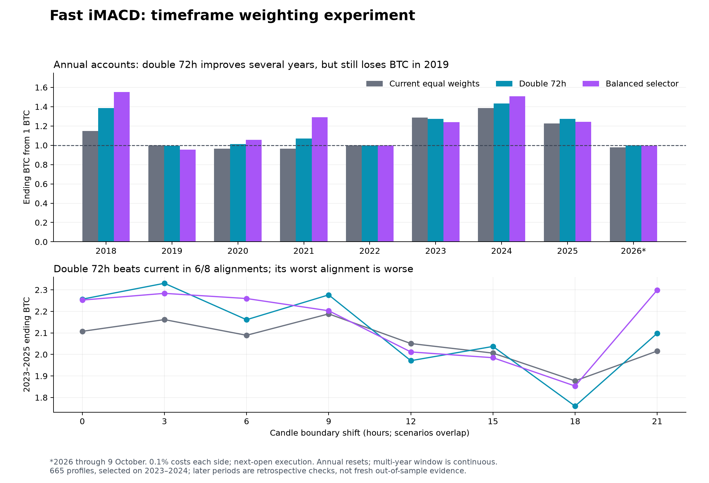

# Fast iMACD timeframe weighting

Completed 18 October 2026. **665 unique weight profiles × eight candle alignments.** Frozen prices through 9 October 2026; 0.10% fees each side; next-four-hour-open execution. All trading rules and the 72% iMACD /28% daily split remain fixed.

**Finding:** the primary training selector chose the simplest useful change: double the 72-hour timeframe and leave the other five equal. Default 2023–2025 accumulation rises from **2.1072 to 2.2566 BTC** (+7.09% relative to the current ending balance). The 2020–2021 result rises from **0.9304 to 1.0838 BTC**. It beats current in six of eight recent-cycle alignments, but has a worse worst-case alignment. This is a promising candidate for prospective comparison, not an established universal upgrade. The deployed BTC/MSTR chart and notification rules were not changed.

## What changed

Within each timeframe, the three iMACD lengths (14/21/34) and their two tests (>zero, >signal) remain equal. Signal smoothing stays at 13. Multipliers are normalized **inside** the iMACD block; we did not accidentally increase or decrease the daily indicators.

| Timeframe | Current share of total breadth | Double 72h | Balanced selector |
|---|---:|---:|---:|
| 4h | 12.00% | 10.29% | 12.00% |
| 8h | 12.00% | 10.29% | 12.00% |
| 12h | 12.00% | 10.29% | 12.00% |
| 24h | 12.00% | 10.29% | 6.00% |
| 48h | 12.00% | 10.29% | 6.00% |
| 72h | 12.00% | 20.57% | 24.00% |

The daily 28% remains SMA 10%, momentum 10%, Donchian 8%. The balanced selector uses relative multipliers **2/2/2/1/1/4**, or equivalently 1/1/1/0.5/0.5/2. A 50% weighted breadth reading is a score threshold, not a 50% probability.

## Selection and annual results

The primary selector uses the lower quartile of 2023–2024 log BTC across the eight alignments, requiring at least five completed trades per alignment. The secondary selector combines 60% recent, 30% 2019–2021 and 10% 2015–2017 annualized lower-quartile scores. Neither uses 2025/2026 to select weights, but those years and the strategy itself were studied previously.

Every annual account starts with 1 BTC. Multi-year windows carry continuously, so annual figures need not multiply to the multi-year balance. * means cash valued as purchasable BTC after its buy fee.

| Window | Current | Double 72h | Balanced selector |
|---|---:|---:|---:|
| 2018 | 1.1493 | 1.3843 | 1.5517 |
| 2019 | 0.9977 | 0.9970 | 0.9555 |
| 2020 | 0.9646 | 1.0135 | 1.0580 |
| 2021 | 0.9646 | 1.0694 | 1.2902 |
| 2022 | 1.0000 | 1.0000 | 1.0000 |
| 2023 | 1.2855 | 1.2737 | 1.2402 |
| 2024 | 1.3863* | 1.4339* | 1.5074* |
| 2025 | 1.2256 | 1.2735 | 1.2420 |
| 2026 through Oct 9 | 0.9774 | 1.0000 | 0.9939 |
| 2020-21 | 0.9304 | 1.0838 | 1.3650 |
| 2023–2024 selection | 1.7820* | 1.8264* | 1.8694* |
| 2023-25 | 2.1072 | 2.2566 | 2.2524 |
| 2025-26 | 1.1979 | 1.2735 | 1.2344 |
| 2015-17 | 1.1340* | 1.1239 | 0.9993 |
| 2019-21 | 0.9283 | 1.0806 | 1.3043 |

**2026 is not a successful bear-market cash exit.** Double 72h takes no trades through October 9 and holds its initial 1 BTC. It avoids the current model’s September 16–18 loss of 2.26% BTC, but still experiences **39.98% dollar drawdown** and a **-5.72%** dollar return. Neither weighting scheme adds a bear exit.

## Does it survive candle timing?

| Window | Current range | Double 72h range | Beats current | Balanced range | Beats current |
|---|---:|---:|---:|---:|---:|
| 2020-21 | 0.9304–1.2643 | 1.0838–1.3618 | 5/8 | 1.0767–1.7042 | 7/8 |
| train | 1.5886–1.8554 | 1.6063–1.8835 | 5/8 | 1.5290–1.9786 | 5/8 |
| 2023-25 | 1.8771–2.1882 | 1.7599–2.3304 | 6/8 | 1.8532–2.2990 | 5/8 |
| 2025 | 1.1397–1.3052 | 1.0883–1.2788 | 5/8 | 1.1804–1.3048 | 6/8 |
| 2025-26 | 1.1331–1.2803 | 1.0883–1.2788 | 5/8 | 1.1804–1.3048 | 6/8 |

Double 72h’s recent-cycle minimum is **1.7599**, below current’s **1.8771**. Its 2025 minimum is also lower (1.0883 vs 1.1397). These scenarios overlap; six wins out of eight is not a 75% probability of future outperformance.

## Fees and delayed execution

Double 72h, compared against current under the **same** stress:

| Stress | Current 2023–25 | Double 72h 2023–25 | Phase wins | Double 72h minimum | 2025–26 minimum |
|---|---:|---:|---:|---:|---:|
| 0.3% per side | 1.8991 | 2.0500 | 6/8 | 1.5797 | 1.0498 |
| Extra 4h | 2.1646 | 2.5368 | 4/8 | 1.7288 | 1.0588 |
| 0.3% + extra 4h | 1.9508 | 2.3046 | 4/8 | 1.5518 | 1.0214 |
| Extra 24h | 1.8750 | 1.9540 | 6/8 | 1.2354 | 0.8830 |

At 0.3% per side, double 72h still finishes 2020–2021 above 1 BTC in all eight phases (minimum 1.0166). But an extra 4h delay reduces recent-cycle phase wins to 4/8. A 24h delay produces a 2025–2026 loss in its worst phase (0.8830 BTC). Execution sensitivity remains.

## What improved in 2025?

Double 72h makes **eight round trips**, versus ten for current. It skips the losing June 6–7 and August 3–4 trades. The June 18 exit becomes June 21, with a small loss still present. Other differences include a slightly earlier January recovery, later October 12 exit, and earlier October 28 exit before November’s buyback. This is not simply delaying every trade.

| Double 72h sale (UTC) | Buyback (UTC) | BTC change | Buyback trigger |
|---|---|---:|---|
| 2025-01-09 08:00 | 2025-01-14 16:00 | -3.56% | recovery |
| 2025-02-02 20:00 | 2025-02-09 20:00 | +2.09% | timeout |
| 2025-02-22 08:00 | 2025-02-25 16:00 | +10.16% | target |
| 2025-06-21 08:00 | 2025-06-24 08:00 | -1.60% | recovery |
| 2025-08-19 08:00 | 2025-08-26 08:00 | +4.03% | timeout |
| 2025-09-23 08:00 | 2025-09-30 08:00 | -0.73% | timeout |
| 2025-10-12 08:00 | 2025-10-19 08:00 | +4.23% | timeout |
| 2025-10-28 16:00 | 2025-11-04 16:00 | +10.87% | target |

These gains compound. The 2025 result rises from 1.2256 to 1.2735 BTC; sampled BTC drawdown changes from -9.43% to -9.34%, and dollar drawdown from -24.72% to -24.16%.

Removing each rule’s single best completed cash-leg multiplier from its fixed 2023–2025 ledger leaves 1.8879 BTC for current and 2.0226 for double 72h. The difference is not entirely one exceptional trade. This is a concentration diagnostic, not a rerun with changed decisions.

## Simpler controls and nearby weights

| Profile | 2020–21 | 2023–25 | 2025 | 2026 |
|---|---:|---:|---:|---:|
| equal | 0.9304 | 2.1072 | 1.2256 | 0.9774 |
| half_4h_8h | 1.0376 | 1.7842 | 1.0922 | 1.0000 |
| fast_emphasis | 0.9814* | 1.7495 | 1.1634 | 0.9548* |
| slow_emphasis | 1.0706 | 1.9771 | 1.0930 | 1.0000 |

Halving 4h/8h weights or doubling the whole slow group gives up recent-cycle BTC. The result favors the 72h timeframe specifically, not a blanket preference for all slow signals.

| Move selected weights toward equal | 2023–2025 BTC | 2025 BTC |
|---|---:|---:|
| 25% | 2.1806 | 1.2441 |
| 50% | 2.2182 | 1.2297 |
| 75% | 2.0806 | 1.2208 |

The 25% and 50% shrinkage diagnostics retain a default recent-cycle improvement; 75% shrinkage falls slightly below current. The discrete trading threshold makes outcomes non-smooth.

Top ten **training-ranked**, without reselection on later results:

| Relative weights: 4/8/12/24/48/72h | 2023–2025 BTC | Phase wins vs current |
|---|---:|---:|
| 1/1/1/1/1/2 | 2.2566 | 6/8 |
| 1/4/4/1/4/4 | 2.1676 | 4/8 |
| 2/2/4/1/1/4 | 1.9796 | 7/8 |
| 1/2/2/1/2/2 | 2.1358 | 3/8 |
| 2/2/2/2/1/4 | 2.2694 | 5/8 |
| 1/4/4/2/4/4 | 2.1107 | 4/8 |
| 2/1/4/2/1/4 | 2.1779 | 5/8 |
| 2/1/4/1/1/4 | 2.1405 | 6/8 |
| 2/1/4/2/2/4 | 2.1607 | 5/8 |
| 2/2/4/1/2/4 | 2.2265 | 6/8 |

## Data, reproducibility and decision

The shared historical input contains 122 missing hourly timestamps across 27 gaps from 2018 onward, mostly in 2018–2021; the only 2023+ gap is one hour on March 24, 2023. We preserve the same input and aggregation behavior for exact comparison with the deployed model. No gap filling was added. Older-cycle robustness remains conditional on that history; this study does not independently certify data completeness. Pre-2017 inputs use the existing rescaled Bitstamp splice; 2018+ uses Binance. See [the input audit](data-audit.json).

Validation passed: **126 baseline report comparisons**, **1330 future-truncation profile checks**, independent selected fee accounting, and **45 Python/production-JavaScript ledgers (1031 fills)**. The JavaScript check instruments an in-memory copy of the production calculator; it does not edit the live strategy. Selected truncated ledgers also match their full-history prefixes.

**Decision:** retain double 72h as the primary candidate for forward comparison. Its simplicity, improved default recent/older cycles and higher-cost survival make it stronger than the broad fast/slow alternatives tested here. The lower worst-case recent result, execution sensitivity and repeated use of the same history prevent treating it as a validated live replacement. The balanced profile is a separate trade-off; it improves 2020–2021 more but worsens 2019 and still loses BTC in 2026.

Searching many configurations can fit historical noise. [Bailey et al., The Probability of Backtest Overfitting](https://www.davidhbailey.com/dhbpapers/backtest-prob.pdf) explains this selection problem; this study does not compute a selection-adjusted probability of profit.

Files: [protocol](PROTOCOL.md), [all 665 candidates](candidates.csv), [selected trade ledgers](trades.csv), [phase/stress summary](summary.json). Full all-phase outcomes remain in locally ignored `results-full.json`. Reproduce with `evaluate.py`, `verify-production.mjs`, then `report.py`, using the adjacent quant repository and frozen inputs referenced by the existing research engine.
