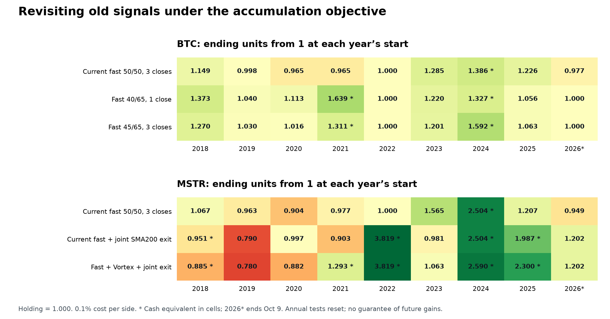

# Old strategies revised for asset accumulation

Research date: October 13, 2026. Frozen price sample through October 9, 2026. Research results only; no site or Telegram rules changed.

**Finding:** threshold changes repair the tested BTC 2020–2021 loss but sacrifice recent-cycle accumulation. Ichimoku did not provide a superior preselected replacement. For MSTR, adding Vortex to BTC breadth is a promising improvement to the prior joint-SMA200 candidate, with meaningful timing sensitivity. There is no single setting that dominates the controls across all years and execution assumptions.

## Objective, scope and selection

Start with one BTC or one split-adjusted MSTR share and maximize fee-net ending units relative to holding, which always ends at one. Include 0.1% per transaction side; no leverage, taxes or cash interest. An asterisk marks cash valued as units at the final close after a hypothetical repurchase fee. These units have not yet been bought. Annual tests restart with one unit; continuous windows carry their portfolio across years. Do not multiply annual rows to recreate continuous tests.

Tested **146 BTC rules and 389 MSTR rules**: 38 BTC threshold/confirmation settings, 96 revisions of the 24 old indicator families, 12 tactical Ichimoku rules, plus MSTR native signals and trend filters. BTC executes at the next four-hour opening; the principal MSTR comparison executes at actual daily openings after the signal is available. Recent MSTR candidates are also checked at regular-session hourly openings.

The balanced selector uses half the mean and half the worst annual log units in 2021–2024. The bull selector uses mean annual log units in 2023–2024. Each family is selected separately using those same dates. Choices are frozen before comparing 2025–2026. Those later prices have already been examined in previous research, so this is retrospective chronological validation, not an untouched holdout. The 535 results are related variants, not 535 independent experiments.

The prior 24-family study optimized dollar Sharpe with a different allocation system. Here its indicator definitions are retained but its ranking and allocation objective are replaced. Families: macd, macdv, zlmacd, stc, elder, hma, trix, aroon, vortex, ichimoku, psar, supert, keltner, ssmooth, itrend, decycler, kama, vma, rsi, donch, wavetrend, dmi, linreg, squeeze.

## BTC: threshold trade-off

50% was already tested against alternatives in the earlier breadth research. This revision extends sell thresholds to 40/45/50/55/60%, recovery thresholds to 45/50/55/60/65%, and one/three consecutive sell closes. Recovery must be at or above the sell threshold. Comparisons are strict: below to sell, above to recover. The BTC bullish SMA200 gate, 10% nominal BTC buyback hurdle and seven-day cash timeout remain unchanged.

The pre-2025 balanced selection is 40% sell /65% recovery with one close. The bull-focused selection is 45%/65% with three closes. Both beat holding in the combined 2020–2021 test, but the current 50/50 strategy earns more BTC in 2023–2025 and 2025–2026.

| Strategy | 2020-21 | 2022 | 2023-25 | validation |
|---|---:|---:|---:|---:|
| Current fast 50/50, 3 closes | 0.930 | 1.000 | 2.107 | 1.198 |
| Fast 40/65, 1 close | 1.824 * | 1.000 | 1.628 | 1.056 |
| Fast 45/65, 3 closes | 1.332 * | 1.000 | 1.948 | 1.063 |

`validation` means January 2025–October 9, 2026. The 2023–2025 and validation windows overlap; they are not independent evidence.

| Strategy | 2018 | 2019 | 2020 | 2021 | 2022 | 2023 | 2024 | 2025 | 2026 |
|---|---:|---:|---:|---:|---:|---:|---:|---:|---:|
| Current fast 50/50, 3 closes | 1.149 | 0.998 | 0.965 | 0.965 | 1.000 | 1.285 | 1.386 * | 1.226 | 0.977 |
| Fast 40/65, 1 close | 1.373 | 1.040 | 1.113 | 1.639 * | 1.000 | 1.220 | 1.327 * | 1.056 | 1.000 |
| Fast 45/65, 3 closes | 1.270 | 1.030 | 1.016 | 1.311 * | 1.000 | 1.201 | 1.592 * | 1.063 | 1.000 |

2026 is partial-year. At the reference candle phase, both revised thresholds avoid an annual unit loss across 2018–2026, but this is not an always-winning property. The 40/65 rule falls to **0.967 BTC** in 2025–2026 with 0.3% costs plus an extra four-hour execution delay. The 45/65 rule falls to **0.940 BTC** in one alternate candle phase over the same period.

The 2020–2021 repair is more convincing than a single favorable alignment: 40/65 ends at 1.106–1.824 BTC across eight candle phases and 1.706 with higher costs plus delay at the reference phase; 45/65 ends at 1.111–1.525 across phases and 1.991 under that combined cost/delay test. These are post-selection diagnostics, not a new selection stage.

**Bear-market distinction:** all three BTC rules finish 2022 at 1.000 BTC because they stay invested. Their 2022 dollar return is −64.2% and sampled dollar drawdown is 67.2%. The bullish SMA200 gate prevents correction trades in a bearish regime; it does not itself liquidate BTC. Improving BTC units is different from protecting dollar value.

A lower selling threshold waits for deeper breadth weakness; a higher recovery threshold waits for a stronger rebound. That can improve a sustained correction and lose ground during a quick recovery. The observed historical trade-off does not establish that either setting predicts crashes.

## Ichimoku and the other old BTC families

Kijun is the midpoint of the previous 26 bars’ highest high and lowest low. Span B uses 52 bars and is plotted 26 bars forward. The cloud shown at today’s coordinate therefore uses spans calculated 26 bars ago. Newly calculated spans use current/past prices; their forward placement does not supply future observations. The test separates displayed Span B from the unshifted 52-bar midpoint. [Fidelity indicator definition](https://www.fidelity.com/learning-center/trading-investing/technical-analysis/technical-indicator-guide/ichimoku-cloud)

These family representatives were picked before the later-period comparison:

| Strategy | 2020-21 | 2023 | 2024 | 2025 | 2026 | 2023-25 | validation |
|---|---:|---:|---:|---:|---:|---:|---:|
| Current fast 50/50, 3 closes | 0.930 | 1.285 | 1.386 * | 1.226 | 0.977 | 2.107 | 1.198 |
| 4h Span B correction, 3 closes | 1.394 * | 0.997 * | 1.108 | 1.125 | 0.979 * | 1.208 | 1.101 * |
| Daily Kijun correction, 3 closes | 0.998 * | 1.014 | 1.114 * | 0.846 | 0.943 | 0.869 | 0.797 |
| Fast + old Ichimoku, 45/55 | 1.688 * | 1.193 | 1.339 * | 1.051 | 1.000 | 1.619 | 1.051 |
| Fast + old VMA, 45/55 | 1.714 * | 1.213 | 1.497 * | 0.996 | 1.000 | 1.717 | 0.996 |

Daily Kijun correction timing loses BTC in both 2025 and 2026. Four-hour Span B performs better, but still accumulates less than the current strategy in the recent cycle. The multi-timeframe old Ichimoku addition fixes some earlier weakness, yet also gives up much of the recent gain. “Leading” Span B is not an early-warning guarantee.

## MSTR: the Vortex addition

The balanced selector chooses **BTC fast + Vortex + joint SMA200 exit**. The bull-only selector chooses the same Vortex breadth without that bear exit. The latter still loses shares in 2026, so the two serve different objectives.

The revised breadth uses 36 fast iMACD vote weights, 36 Vortex vote weights and the existing 14 daily trend votes: iMACD weight falls from 72% to 41.9%; Vortex gets 41.9%; the daily block gets 16.3%. Vortex uses the original 21/34/55 lengths on 4/8/12/24/48/72-hour BTC bars. Its 18 directional conditions each receive weight two to match the old family convention. These are correlated votes, not independent probabilities.

Vortex compares summed upward cross-bar movement, abs(high[t]−low[t−1]), with downward movement, abs(low[t]−high[t−1]). Higher upward movement votes bullish. Three fresh BTC closes below 50% combined breadth initiate a sale while BTC’s SMA200 regime is bullish. Recovery above 50%, the same BTC-based buyback target, or the seven-day timer restores the underlying BTC position.

For the MSTR bear exit, hold only if that BTC position is invested and at least one of BTC or MSTR has a bullish daily SMA200 regime. Each regime needs two daily closes above 102% or below 98% of its SMA200 to switch. Both bearish means cash. BTC uses calendar days; MSTR uses trading sessions. The BTC correction engine keeps running even when the MSTR overlay is in cash.

| Strategy | 2018 | 2019 | 2020 | 2021 | 2022 | 2023 | 2024 | 2025 | 2026 |
|---|---:|---:|---:|---:|---:|---:|---:|---:|---:|
| Current fast 50/50, 3 closes | 1.067 | 0.963 | 0.904 | 0.977 | 1.000 | 1.565 | 2.504 * | 1.207 | 0.949 |
| Current fast + joint SMA200 exit | 0.951 * | 0.790 | 0.997 | 0.903 | 3.819 * | 0.981 | 2.504 * | 1.987 * | 1.202 |
| Fast + Vortex + joint exit | 0.885 * | 0.780 | 0.882 | 1.293 * | 3.819 * | 1.063 | 2.590 * | 2.300 * | 1.202 |

Earlier MSTR years precede its Bitcoin-treasury business. Even so, the new rule’s 2020 loss to **0.882 shares** must remain visible. The better 2021–2026 rows do not mean it always wins.

| Strategy | 2020-21 | 2023-25 | validation |
|---|---:|---:|---:|
| Current fast 50/50, 3 closes | 0.884 | 4.521 | 1.145 |
| Current fast + joint SMA200 exit | 0.901 | 4.665 * | 2.352 |
| Fast + Vortex + joint exit | 1.141 * | 6.057 * | 2.723 |

**Why it improved:** in 2025 it adds a March 28–April 4 cash leg gaining 11.48% in shares; it also changes the August buyback from August 26 to September 2, improving that cash leg from 6.04% to 8.22%. It still loses 7.87% on January 10–15 and 7.23% on February 3–10. This is better correction timing in some cases, not removal of false signals.

The January 2023 regime exit/re-entry still loses 37.34% of shares in both models. Later Vortex timing recovers enough to finish that year at 1.064 instead of 0.981. The 2026 improvement versus unchanged fast comes from the joint bear exit; adding Vortex does not change that year’s 1.202 result.

Over 2025–2026 the Vortex/joint candidate returns **+40.0% in dollars**, versus **+21.0%** for the preceding joint candidate and **−48.6%** for holding. Its sampled dollar drawdown is **33.3%**, versus **34.4%** and **81.9%**, respectively. Share accumulation does not eliminate risk.

## Other MSTR choices

| Strategy | 2022 | 2023 | 2024 | 2025 | 2026 | validation |
|---|---:|---:|---:|---:|---:|---:|
| Current fast + joint SMA200 exit | 3.819 * | 0.981 | 2.504 * | 1.987 * | 1.202 | 2.352 |
| Fast + Vortex + joint exit | 3.819 * | 1.063 | 2.590 * | 2.300 * | 1.202 | 2.723 |
| Hold | 1.000 | 1.000 | 1.000 | 1.000 | 1.000 | 1.000 |
| Fast + either asset above Span B | 1.270 * | 0.939 | 1.669 * | 1.559 * | 1.070 | 1.642 |
| MSTR Tenkan/Kijun cross | 2.897 * | 0.642 | 0.906 * | 1.399 * | 1.489 | 2.052 |
| 4h Span B correction + joint exit | 3.819 * | 1.044 | 1.088 | 1.382 * | 1.148 * | 1.562 * |
| Native MSTR decycler | 1.501 * | 0.638 | 1.560 * | 1.489 * | 1.063 * | 1.559 * |
| Fast 45/60, 3 closes + joint exit | 3.819 * | 0.984 | 2.183 * | 2.264 * | 1.266 | 2.824 |

The selected threshold-only alternative (45% sell /60% recovery, three closes, plus joint exit) reaches 2.824 shares in 2025–2026, higher than Vortex’s 2.723. It was weaker on the original fitting score and recent bull window (4.025 versus 6.057 in 2023–2025). Choosing it now because of the later-period number would add hindsight selection.

The selected Span B filter finishes 2025–2026 at 1.642 shares, below the joint SMA200 control’s 2.352. Its 2022 dollar loss is 67.3%, so it is not a substitute for the existing bear exit. Native Tenkan/Kijun crossing protects some declines but loses substantial share exposure during 2023–2024.

## Robustness and limits

| Test, continuous 2025–2026 | Prior MSTR joint exit | Vortex + joint exit |
|---|---:|---:|
| Daily openings, 0.1%/side | 2.352 | 2.723 |
| Daily openings, 0.3%/side, 0 extra session | 2.251 | 2.585 |
| Daily openings, 0.1%/side, 1 extra session | 1.439 | 1.621 |
| Daily openings, 0.3%/side, 1 extra session | 1.377 | 1.539 |
| Hourly openings, 0.1%/side, 0 extra available bar | 2.335 | 2.708 |
| Hourly openings, 0.3%/side, 0 extra available bar | 2.226 | 2.561 |
| Hourly openings, 0.1%/side, 1 extra available bar | 1.886 | 2.156 |
| Hourly openings, 0.3%/side, 1 extra available bar | 1.798 | 2.038 |

- Vortex beats the preceding joint strategy in seven of eight matched candle phases in 2025–2026, but only four of eight in 2023–2025. Its 2023–2025 result ranges from 3.775 to 6.057; the reference phase is its best. This weakens the claim of a general bull-market improvement.
- A full extra stock-session delay reduces 2023–2025 Vortex units from 6.057 to 1.301; the prior joint rule retains 1.716 under the same delay. Acting promptly matters, and the ranking is not invariant to execution.
- Removing the best completed 2025–2026 cash-leg multiplier leaves 1.231 shares for Vortex versus 1.064 for the prior joint strategy. The dominant shared leg sold October 30, 2025 and bought August 24, 2026. This arithmetic diagnostic is not a counterfactual rerun of the strategy.
- The selected displayed-Span-B MSTR filter varies from 1.464 to 1.745 shares in 2025–2026 with offsets of 25–27 bars; none beats the joint SMA200 control. Offset sensitivity was not used to choose a new winner.
- BTC 40/65 loses its later-period edge over holding when the best completed cash leg is factored out: 1.056 becomes 0.955. Current 50/50 remains at 1.082 by the same diagnostic.
- These are quote-based opening fills with modeled costs, not observed executions. The hourly MSTR data retain nine audited sessions using a daily-candle fallback. Sampled drawdowns omit intrabar extremes. No result establishes a certain crash-versus-consolidation classifier.

## Verification and research decision

- Current BTC model and both MSTR baseline variants reproduce previous period outcomes.
- Kijun and displayed Span B match independent rolling-window/26-bar-shift arithmetic.
- All model events, recovery arrays and native daily signals pass a full future-truncation check.
- Independent BTC ledger reconstruction reconciles all selected end units.
- BTC risk paths use completed four-hour closes; MSTR risk uses session closes.
- Hourly MSTR indicators use completed daily candles and earlier BTC trade targets.

Keep the current BTC rule as the recent-cycle control. Retain 40/65 and 45/65 as explicit historical trade-offs, rather than calling them universal improvements. For MSTR, the Vortex/joint rule deserves prospective comparison with the simpler joint rule; its later-period gain survived the tested costs/hourly execution, but historical timing sensitivity prevents treating it as settled superiority. No live rule changes were made.

All trials, not just winners, are in `ichimoku-candidates.csv` and `ichimoku-results.json`. Selected trade ledgers are in `ichimoku-trades.csv`; detailed execution and concentration diagnostics are in `ichimoku-diagnostics.json`. Definitions, selection dates and safeguards are in `ICHIMOKU_PROTOCOL.md`. Run `ichimoku_revisit.py`, then `ichimoku_diagnostics.py`, then `ichimoku_report.py` to reproduce using the documented adjacent quant data dependency.

